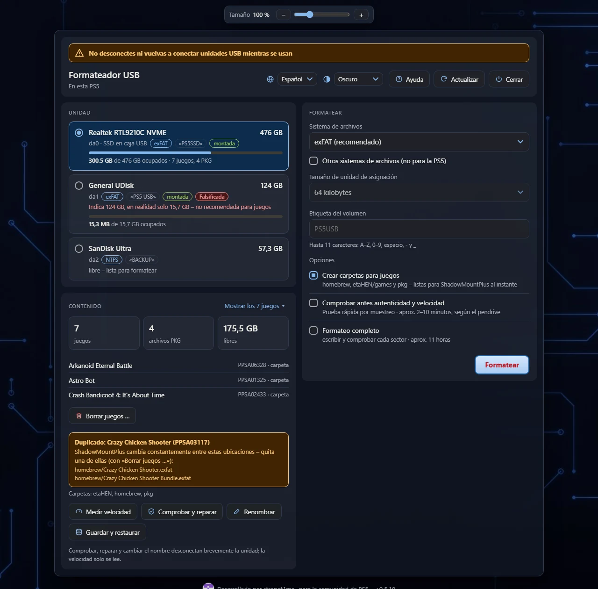
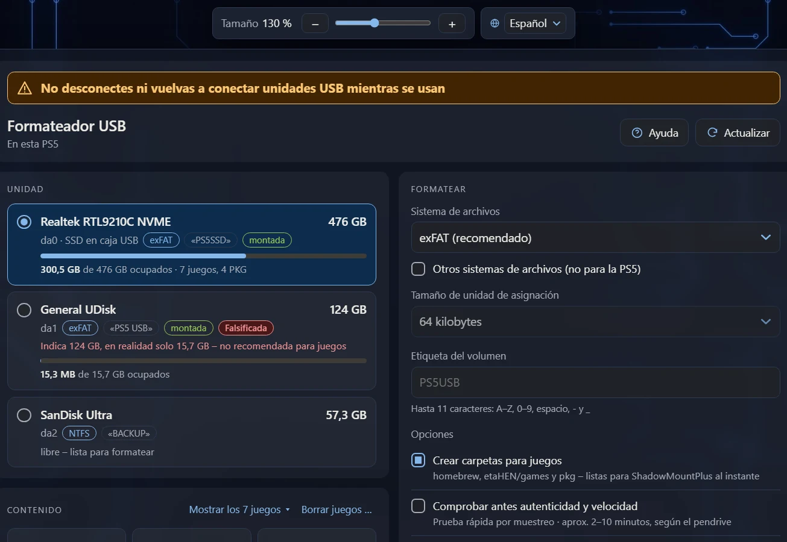
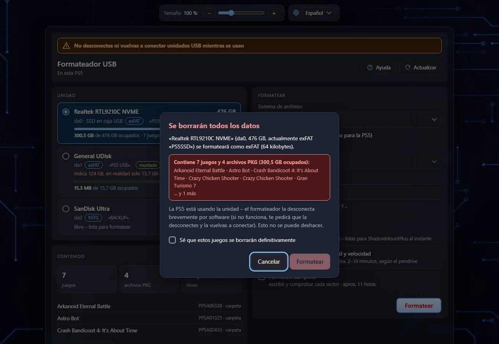
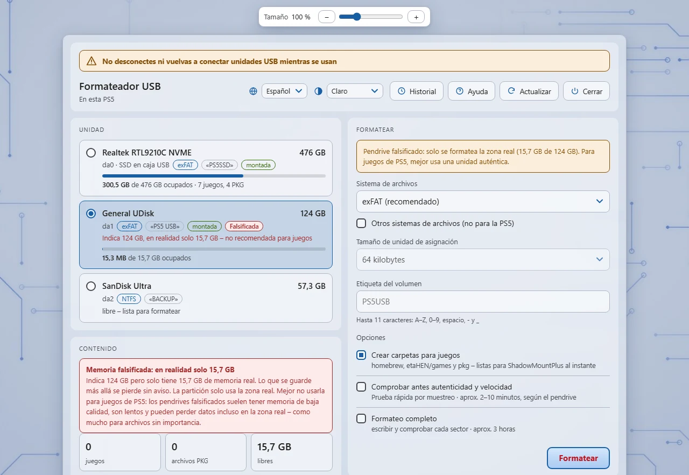
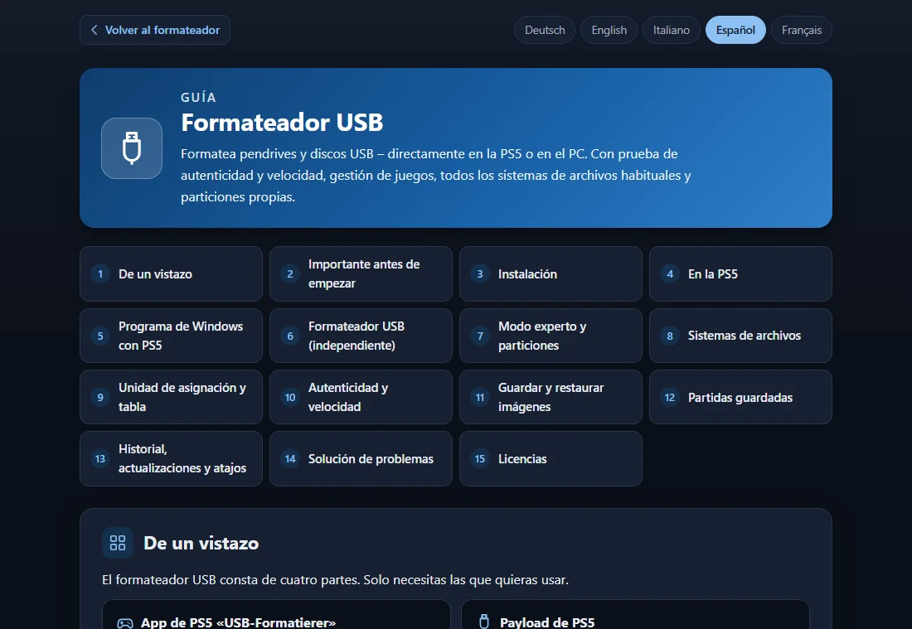
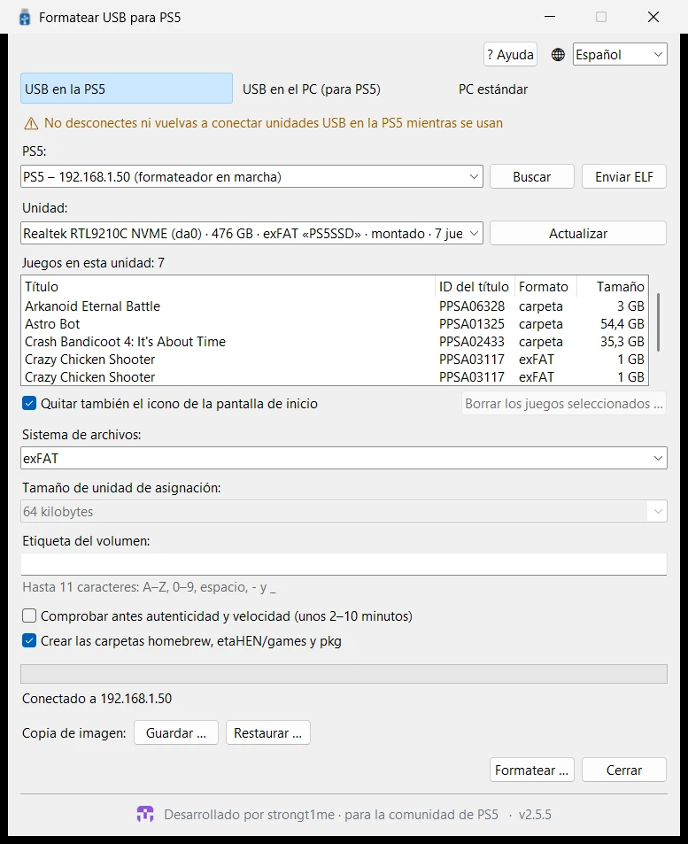
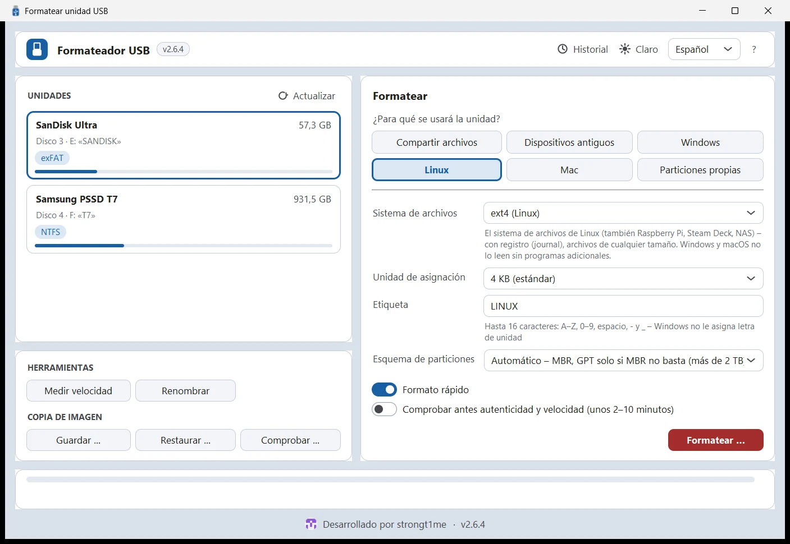
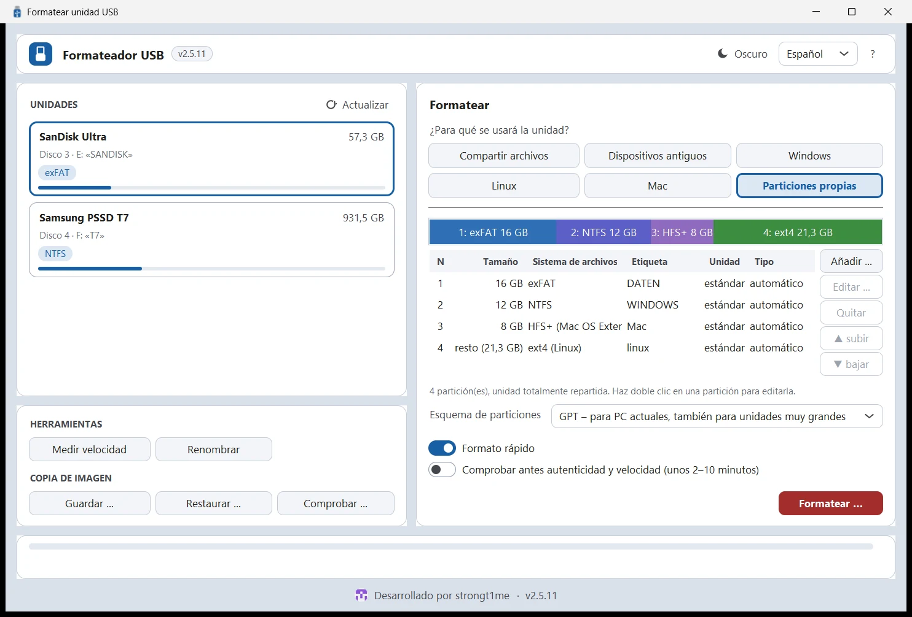

# Formateador USB

**Formatea pendrives y discos USB – directamente en la PS5 o en el PC.** 
Con prueba de autenticidad y velocidad, gestión de juegos, todos los sistemas de archivos habituales y particiones propias.

[Funciones](#-funciones) · [Descarga](#-descarga) · [Primeros pasos](#-primeros-pasos) · [Capturas](#-capturas) · [Compilar](#-compilar) · [Licencias](#-licencias)

[Deutsch](README.md) · [English](README.en.md) · [Italiano](README.it.md) · **Español** · [Français](README.fr.md)

## ✨ Funciones

<table>
<tr>
<td width="33%" valign="top">

### 🎮 Hecho para la PS5
exFAT con 64 KB – ideal para ShadowMountPlus. Crea al momento las carpetas `homebrew`, `etaHEN/games` y `pkg`. Se inicia desde su propio icono.

</td>
<td width="33%" valign="top">

### 🔌 Sin desconectar
El formateador desconecta por software las unidades montadas y las toma antes de que la PS5 vuelva a montarlas.

</td>
<td width="33%" valign="top">

### 🕹️ Juegos a la vista
Juegos (carpetas e imágenes con ID de título), archivos PKG y ocupación. Detecta juegos duplicados y borra juegos junto con su icono.

</td>
</tr>
<tr>
<td valign="top">

### 🛡️ Prueba de autenticidad
Detecta pendrives con capacidad falsificada y, si quieres, formatea solo la zona real. Mide la velocidad de lectura y escritura.

</td>
<td valign="top">

### 🧩 Todos los sistemas de archivos
exFAT, FAT32 (también de más de 32 GB), NTFS, FAT16, ext4/ext3/ext2 y HFS+ – con la unidad de asignación que quieras.

</td>
<td valign="top">

### 🗂️ Modo experto
Varias particiones con MBR (hasta 4) o GPT (hasta 16): sistema de archivos, tamaño, tipo, etiqueta, arrancable.

</td>
</tr>
<tr>
<td valign="top">

### 🩺 Comprobar y reparar
Comprueba y repara exFAT, renombra unidades sin perder datos, formateo completo que escribe y comprueba cada sector.

</td>
<td valign="top">

### 🌍 Cinco idiomas
Deutsch, English, Italiano, Español y Français – con una guía detallada tras el botón «Ayuda».

</td>
<td valign="top">

### 📱 Úsalo donde quieras
Navegador de la PS5, móvil o PC (código QR) y dos programas de PC para Windows y Linux. Tema claro u oscuro, tamaño ajustable.

</td>
</tr>
</table>

## 📦 Descarga

Todos los archivos están en la [última versión](../../releases/latest).

| Archivo | Para qué |
|---|---|
| `PPSA86920.zip` | **Icono de la app para la PS5:** descomprime y copia la carpeta `PPSA86920` en `/data/homebrew/` (por ejemplo, por FTP). ShadowMountPlus registra la app. |
| `usb_format.elf` | **El formateador (payload).** La app lo inicia sola; sin la app, envíalo al cargador ELF (puerto 9021). |
| `PS5-USB-Formatierer.exe` | **Programa de Windows con funciones de PS5:** USB en la PS5 (por red), USB en el PC para la PS5, PC estándar. |
| `USB-Formatierer.exe` | **Programa de Windows sin funciones de PS5:** todos los sistemas de archivos, particiones y modo experto. |
| `PS5-USB-Formatierer-linux-x86_64.tar.gz` `USB-Formatierer-linux-x86_64.tar.gz` | **Los mismos dos programas para Linux** (x86_64): descomprimir y ejecutar. |

**Requisitos:** una PS5 con jailbreak activo y cargador ELF (probado con el firmware 12.00); ShadowMountPlus para el icono de la app y para borrar juegos. Windows 10 u 11 (64 bits); para formatear en el PC, Windows pide una vez permisos de administrador. Linux (x86_64): para formatear, el sistema pide la contraseña de administrador (pkexec/polkit); NTFS, FAT16 y ext los escriben las herramientas del sistema de `ntfs-3g`, `dosfstools` y `e2fsprogs`. La versión para Mac llegará más adelante.

## 🚀 Primeros pasos

1. **Instalar:** copia la carpeta `PPSA86920` del ZIP en `/data/homebrew/` de la PS5.
2. **Iniciar:** carga el jailbreak y abre el icono **USB-Formatierer**. La interfaz aparece en el navegador de la PS5 – con el código QR o en `http://<IP-PS5>:8090` también en el móvil o el PC.
3. **Formatear:** elige la unidad, ajusta el sistema de archivos y la etiqueta, pulsa **Formatear** – listo.

> [!WARNING]
> Mientras se usa, no desconectes ni vuelvas a conectar unidades USB en la PS5. La PS5 las vincula a los juegos y aplicaciones en ejecución – después, a menudo solo vuelven a iniciarse tras reiniciar la consola. Desconecta solo cuando el formateador te lo pida expresamente.

El botón **Ayuda** abre la guía detallada en cinco idiomas – en la interfaz web y en los programas de PC.

## 🖼️ Capturas

<table>
<tr>
<td width="50%" align="center"> <b>En el navegador de la PS5 en el televisor</b></td>
<td width="50%" align="center"> <b>Confirmación – si la unidad tiene juegos, hay que confirmarlo expresamente</b></td>
</tr>
<tr>
<td align="center"> <b>Tema claro – pendrive falsificado detectado, solo se usa la zona real</b></td>
<td align="center"> <b>Guía en cinco idiomas tras el botón «Ayuda»</b></td>
</tr>
<tr>
<td align="center"> <b>Windows: USB en la PS5 – encuentra la PS5 en la red doméstica</b></td>
<td align="center"> <b>Windows: Formateador USB – todos los sistemas de archivos</b></td>
</tr>
<tr>
<td colspan="2" align="center"> <b>Modo experto – particiones propias con exFAT, NTFS, HFS+ y ext4</b></td>
</tr>
</table>

## 🛠️ Compilar

| Parte | Cómo |
|---|---|
| Payload e inicio de la app | WSL/Linux con [ps5-payload-sdk](https://github.com/ps5-payload-dev/sdk): `make -C usb_format all app PS5_PAYLOAD_SDK=…` (`app` necesita `ps5-native-tool`, ver `usb_format/app/build_title.sh`) |
| Carpeta de la app | `usb_format/dump/build.ps1` (.NET 10) |
| Programas de Windows | `windows/build_exe.bat` (Python con PyInstaller, Pillow y ziglang) – compila también el ayudante `usbfmt_win.exe` y `mke2fs.exe` |
| Programas de Linux | `windows/build_linux.sh [usb_format.elf]` (Python 3 con tkinter, PyInstaller y Pillow, gcc) – compila también el ayudante `usbfmt_linux`. La CI (`.github/workflows/linux.yml`) compila y prueba todo en Ubuntu, también con dispositivos loop. |
| Pruebas | Linux/WSL: `usb_format/test/*.sh` |
| Traducciones | `usb_format/i18n/*.json` (`tools/i18n_gen.py`, `tools/web_i18n.py`) y `windows/i18n_app.json` (`windows/i18n_check.py`) |

## 📄 Licencias

El Formateador USB se distribuye bajo la [GNU General Public License 3.0](LICENSE). El código de terceros incluido conserva su propia licencia:

- `usb_format/third_party/exfatprogs` – exfatprogs 1.4.3, **GPL-2.0-or-later** (fsck.exfat está integrado en el formateador, por lo que `usb_format.elf` también está sujeto a la GPL)
- `usb_format/tools/bin` – mkntfs (ntfs-3g) y mke2fs (e2fsprogs), GPL, ver `THIRD_PARTY_NOTICES.txt`
- `windows/mke2fs` – mke2fs de e2fsprogs 1.47.1 para ext2/3/4 en el PC, GPL, ver `NOTICE.txt`
- `usb_format/app/sce_module/libc.prx` – GPL-3.0-or-later, ver `NOTICE.txt`

Uso bajo tu propia responsabilidad – haz antes una copia de seguridad de los datos importantes.
