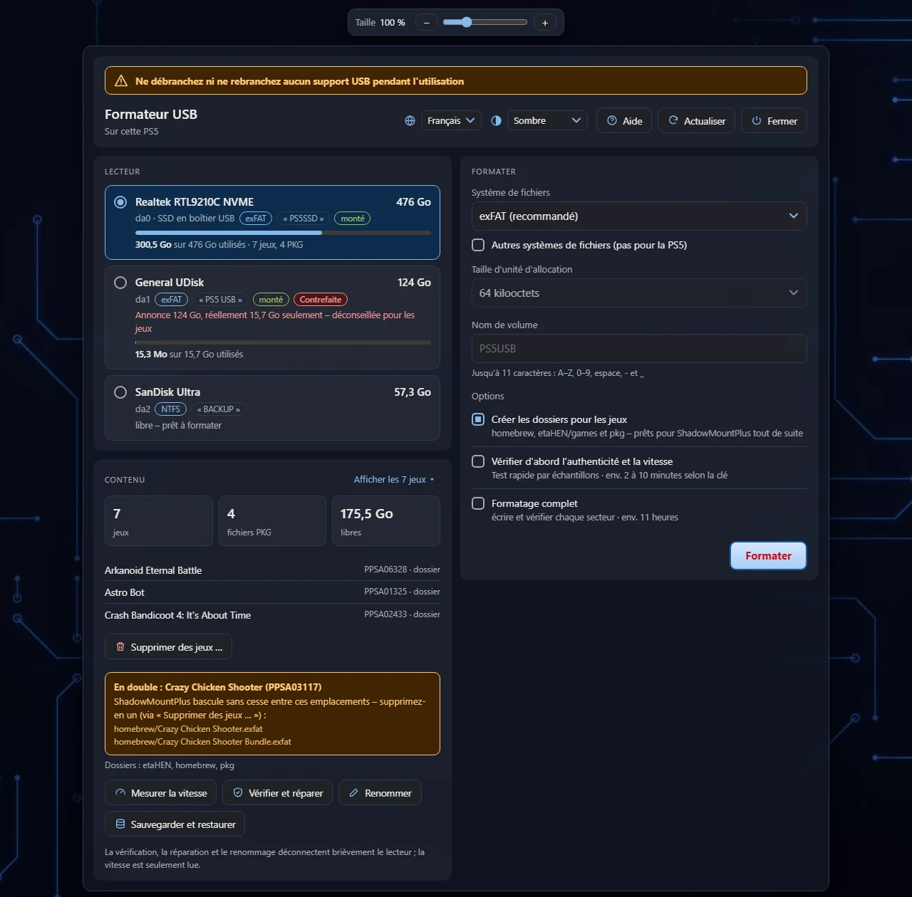
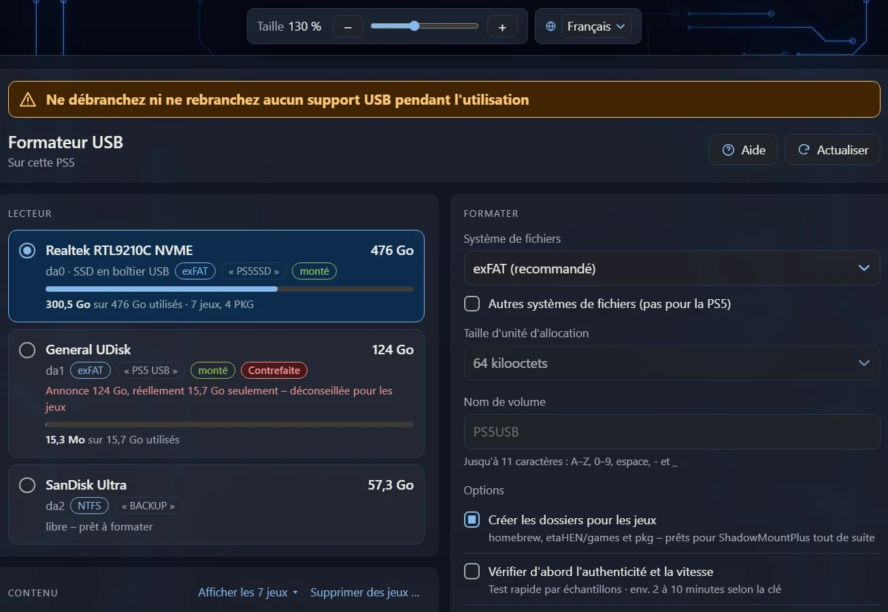
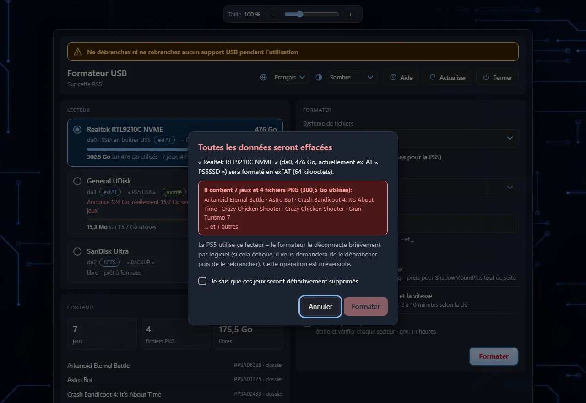
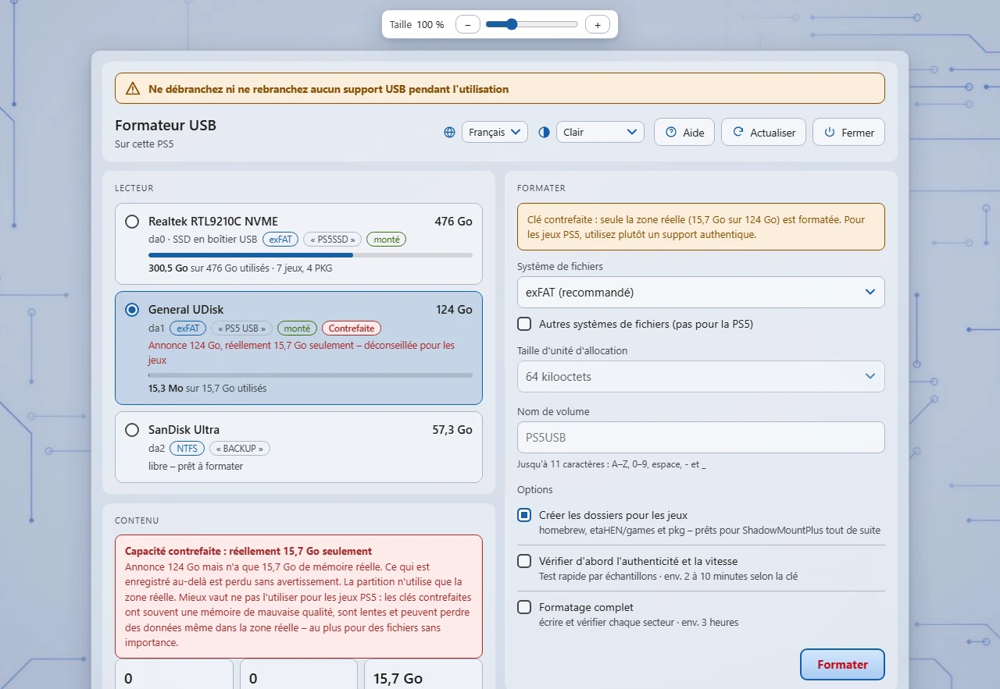
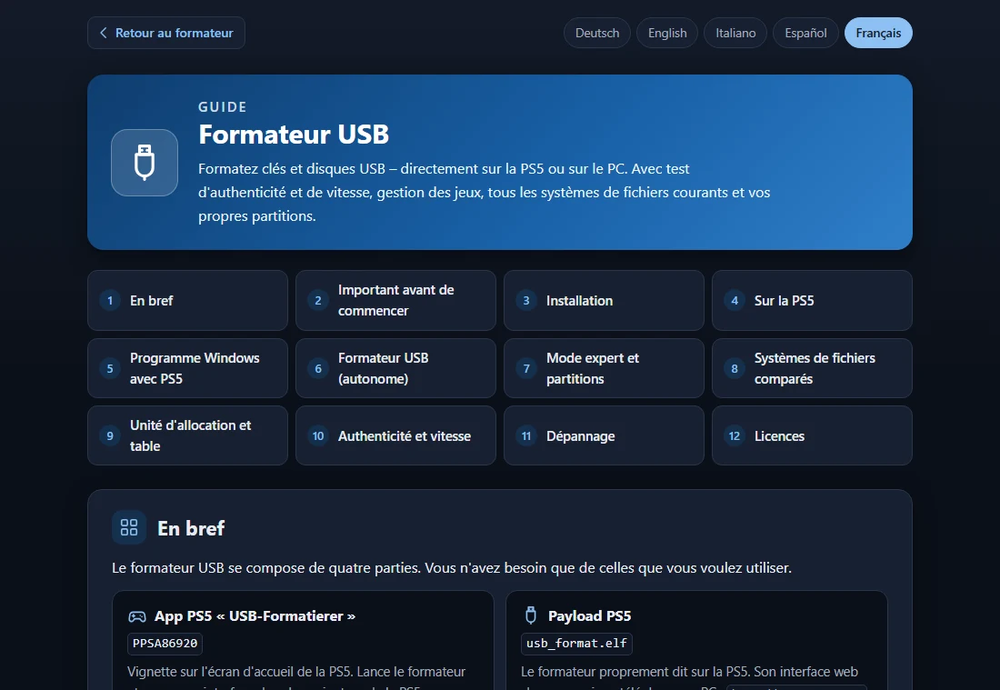
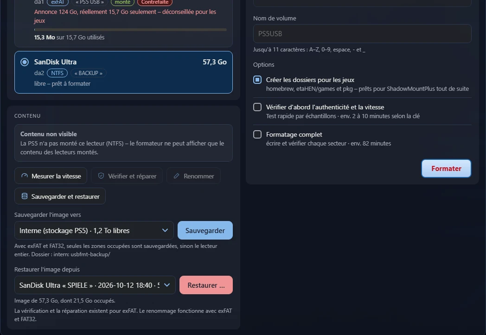
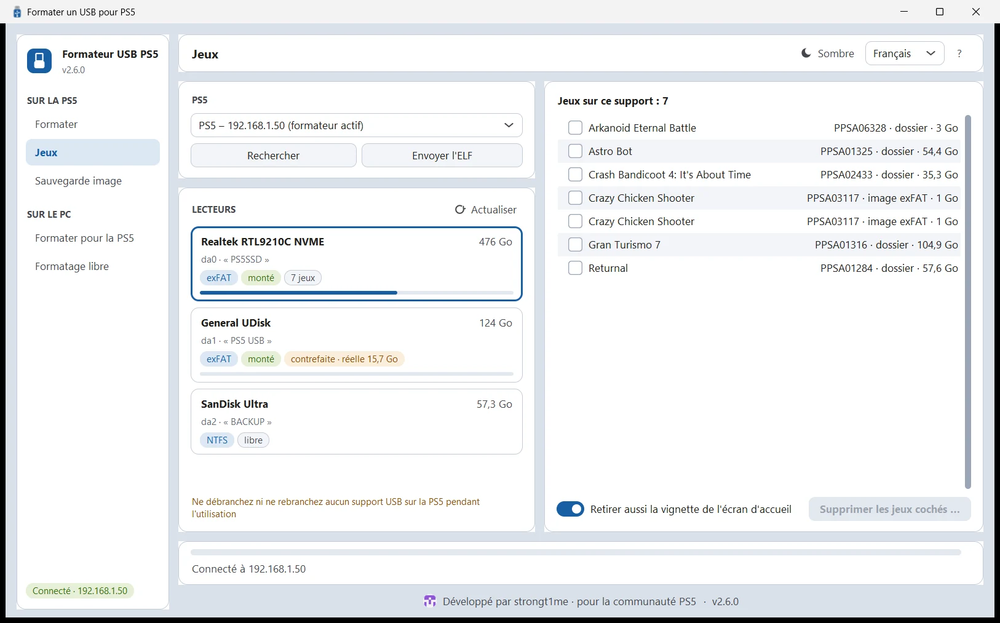
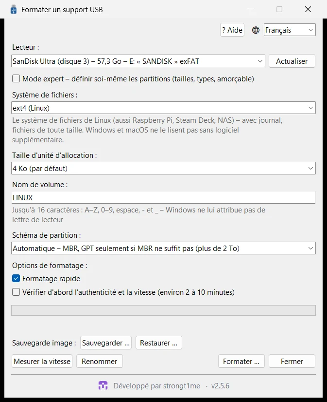
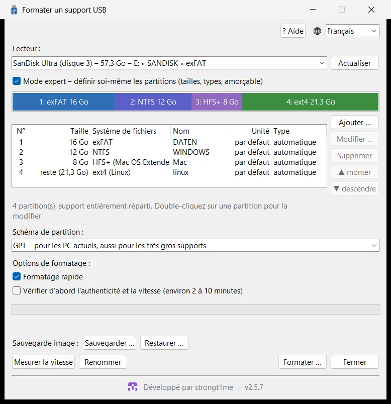

# Formateur USB

**Formatez clés et disques USB – directement sur la PS5 ou sur le PC.** 
Avec test d'authenticité et de vitesse, sauvegarde image, gestion des jeux, tous les systèmes de fichiers courants et vos propres partitions.

[Fonctions](#-fonctions) · [Téléchargement](#-téléchargement) · [Démarrage rapide](#-démarrage-rapide) · [Aperçus](#-aperçus) · [Compiler](#-compiler) · [Licences](#-licences)

[Deutsch](README.de.md) · [English](README.md) · [Italiano](README.it.md) · [Español](README.es.md) · **Français**

## ✨ Fonctions

<table>
<tr>
<td width="33%" valign="top">

### 🎮 Conçu pour la PS5
exFAT avec 64 Ko – idéal pour ShadowMountPlus. Crée tout de suite les dossiers `homebrew`, `etaHEN/games` et `pkg`. Se lance depuis sa propre vignette.

</td>
<td width="33%" valign="top">

### 🔌 Sans débrancher
Le formateur déconnecte par logiciel les lecteurs montés et les reprend avant que la PS5 ne les remonte.

</td>
<td width="33%" valign="top">

### 🕹️ Les jeux en un coup d'œil
Jeux (dossiers et images avec ID de titre), fichiers PKG et occupation. Détecte les jeux en double, supprime les jeux avec leur vignette via « Supprimer des jeux … ».

</td>
</tr>
<tr>
<td valign="top">

### 🛡️ Test d'authenticité
Détecte les clés à capacité contrefaite et, si vous le souhaitez, ne formate que la zone réelle. Mesure les vitesses de lecture et d'écriture.

</td>
<td valign="top">

### 🧩 Tous les systèmes de fichiers
exFAT, FAT32 (même au-delà de 32 Go), NTFS, FAT16, ext4/ext3/ext2 et HFS+ – unité d'allocation au choix.

</td>
<td valign="top">

### 🗂️ Mode expert
Plusieurs partitions en MBR (jusqu'à 4) ou GPT (jusqu'à 16) : système de fichiers, taille, type, nom, amorçable.

</td>
</tr>
<tr>
<td valign="top">

### 🩺 Vérifier et réparer
Vérifie et répare exFAT, renomme les lecteurs sans perte de données, formatage complet qui écrit et vérifie chaque secteur.

</td>
<td valign="top">

### 🌍 Cinq langues
Deutsch, English, Italiano, Español et Français – avec un guide détaillé derrière le bouton « Aide ».

</td>
<td valign="top">

### 📱 Utilisable partout
Navigateur de la PS5, téléphone ou PC (code QR) et deux programmes PC pour Windows et Linux. Thème clair ou sombre, taille réglable.

</td>
</tr>
<tr>
<td valign="top">

### 📤 Envoyer l'ELF
Le programme PC envoie le formateur intégré à la PS5 d'un clic (port 9021) – et remplace une ancienne version déjà lancée.

</td>
<td valign="top">

### 📡 Trouve la PS5
Les programmes PC trouvent seuls la PS5 sur le réseau domestique – même depuis WSL ou une machine virtuelle.

</td>
<td valign="top">

### 🔒 Pas de confusion
Contrôle du numéro de série : si une autre clé du même modèle est branchée entre-temps, rien n'est formaté. Après le résultat « contrefaite » ou « défectueuse », l'ancien système de fichiers à moitié écrasé est supprimé.

</td>
</tr>
<tr>
<td colspan="3" valign="top">

### 💾 Sauvegarder et restaurer des images
Sauvegarde un lecteur entier en <code>.img.zst</code> – seulement les zones occupées, compressées avec zstd, avec un <code>.sha256</code>. Sur la PS5 vers le stockage interne, un autre lecteur USB ou en téléchargement ; sur le PC dans n'importe quel dossier, même depuis des clés et cartes SD verrouillées en écriture. Réécriture avec vérification ensuite – aussi par envoi depuis un téléphone ou un PC. <code>zstd -d</code> en fait une image ordinaire.

### 🎮 Sauvegardes : copier et restaurer
Affiche les sauvegardes PS5 avec le nom du jeu et l'utilisateur, permet d'en cocher plusieurs et de les sauvegarder – en téléchargement ZIP ou sur la PS5 elle-même (interne <code>/data/game_saves</code> ou <code>game_saves</code> d'un lecteur USB). Le conteneur chiffré reste inchangé. Pour restaurer, le formateur liste les sauvegardes trouvées par utilisateur (ou on utilise un ZIP de l'appareil). Les sommes de contrôle sont vérifiées, un jeu en cours bloque les modifications. Sauvegardes PS5 et PS4 (PS4 avec son fichier de clé), la seconde copie système (sce_bu) n'est pas listée ; sauvegarde et restauration peuvent être annulées.

</td>
</tr>
<tr>
<td valign="top">

### 🕓 Historique
Les dernières tâches et leur résultat – sur la PS5 et sur le PC. Chaque lecteur indique ce qui lui est arrivé en dernier.

</td>
<td valign="top">

### 🔔 Toujours à jour
Avis de nouvelles versions dans l'interface web et les programmes PC ; « Nouveautés » avec le téléchargement du bon fichier et de sa somme de contrôle.

</td>
<td valign="top">

### ⌨️ Raccourcis
Programmes PC : F1 guide, F5 relire, Ctrl+1 … 5 pages, Ctrl+F rechercher des jeux, Ctrl+H historique.

</td>
</tr>
</table>

## 📦 Téléchargement

Tous les fichiers se trouvent dans la [dernière version](../../releases/latest).

| Fichier | Rôle |
|---|---|
| `PPSA86920.zip` | **Vignette de l'app pour la PS5 :** décompressez et copiez le dossier `PPSA86920` dans `/data/homebrew/` (par ex. via FTP). ShadowMountPlus enregistre l'app. |
| `usb_format.elf` | **Le formateur (payload).** L'app le lance elle-même, le programme PC l'envoie via « Envoyer l'ELF » ; sinon, envoyez-le à la main au chargeur ELF (port 9021). |
| `PS5-USB-Formatierer.exe` | **Programme Windows avec fonctions PS5 :** « Sur la PS5 » (via le réseau), « Sur le PC – pour PS5 », « Sur le PC – libre » – avec l'ELF intégré. |
| `USB-Formatierer.exe` | **Programme Windows sans fonctions PS5 :** tous les systèmes de fichiers, partitions et mode expert. |
| `PS5-USB-Formatierer-x86_64.AppImage` `USB-Formatierer-x86_64.AppImage` | **Les deux mêmes programmes pour Linux** en AppImage : le rendre exécutable (`chmod +x`) et le lancer – aucune installation. Pour ARM64 (p. ex. Raspberry Pi 4/5), les fichiers avec `aarch64`. |
| `PS5-USB-Formatierer-linux-x86_64.tar.gz` `USB-Formatierer-linux-x86_64.tar.gz` | Les mêmes programmes Linux en archive : décompresser et lancer (aussi en `aarch64`). |
| `SHA256SUMS` | **Sommes de contrôle de tous les fichiers** pour vérifier les téléchargements : `sha256sum -c --ignore-missing SHA256SUMS` (Windows : `certutil -hashfile <fichier> SHA256`). |

**Prérequis :** une PS5 avec un jailbreak actif et un chargeur ELF (testé avec le firmware 12.00) ; ShadowMountPlus pour la vignette de l'app et la suppression des jeux. Windows 10 ou 11 (64 bits) ; pour formater sur le PC, Windows demande une fois les droits d'administrateur. Linux (x86_64 ou ARM64) : pour formater, le système demande le mot de passe administrateur (pkexec/polkit) ; NTFS, FAT16 et ext sont écrits par les outils système de `ntfs-3g`, `dosfstools` et `e2fsprogs`.

## 🚀 Démarrage rapide

1. **Installer :** copiez le dossier `PPSA86920` du ZIP dans `/data/homebrew/` sur la PS5.
2. **Lancer :** chargez le jailbreak et ouvrez la vignette **USB-Formatierer**. L'interface s'affiche dans le navigateur de la PS5 – via le code QR ou à l'adresse `http://<IP-PS5>:8090` aussi sur téléphone ou PC. Sans vignette : dans le programme PC « PS5-USB-Formatierer », cliquez sur **Envoyer l'ELF**.
3. **Formater :** choisissez un lecteur, réglez le système de fichiers et le nom, appuyez sur **Formater** – c'est fait.

> [!WARNING]
> Pendant l'utilisation, ne débranchez ni ne rebranchez aucun support USB sur la PS5. Elle les rattache aux jeux et applications en cours – ceux-ci ne redémarrent souvent qu'après un redémarrage de la console. Ne débranchez que si le formateur vous le demande expressément.

Le bouton **Aide** ouvre le guide détaillé en cinq langues – dans l'interface web et dans les programmes PC.

## 🖼️ Aperçus

<table>
<tr>
<td width="50%" align="center"> <b>Dans le navigateur de la PS5 sur le téléviseur</b></td>
<td width="50%" align="center"> <b>Confirmation – si le lecteur contient des jeux, il faut le confirmer expressément</b></td>
</tr>
<tr>
<td align="center"> <b>Thème clair – clé contrefaite détectée, seule la zone réelle est utilisée</b></td>
<td align="center"> <b>Guide en cinq langues derrière le bouton « Aide »</b></td>
</tr>
<tr>
<td colspan="2" align="center"> <b>Sauvegarder et restaurer des images – en interne, sur un autre lecteur USB ou en téléchargement</b></td>
</tr>
<tr>
<td align="center"> <b>Windows : Sur la PS5 – trouve seul la PS5, « Envoyer l'ELF » y envoie le formateur</b></td>
<td align="center"> <b>Windows : Formateur USB – tous les systèmes de fichiers</b></td>
</tr>
<tr>
<td colspan="2" align="center"> <b>Mode expert – vos propres partitions avec exFAT, NTFS, HFS+ et ext4</b></td>
</tr>
</table>

## 🛠️ Compiler

| Partie | Comment faire |
|---|---|
| Payload et lanceur de l'app | WSL/Linux avec [ps5-payload-sdk](https://github.com/ps5-payload-dev/sdk) : `make -C usb_format all app PS5_PAYLOAD_SDK=…` (`app` nécessite `ps5-native-tool`, voir `usb_format/app/build_title.sh`) |
| Dossier de l'app | `usb_format/dump/build.ps1` (.NET 10) |
| Programmes Windows | `windows/build_exe.bat` (outils : `pip install -r windows/requirements-build.txt`) – compile aussi l'assistant `usbfmt_win.exe` et `mke2fs.exe` |
| Programmes Linux | `windows/build_linux.sh [usb_format.elf]` (Python 3 avec tkinter, PyInstaller et Pillow, gcc) – compile aussi l'assistant `usbfmt_linux`. La CI (`.github/workflows/linux.yml`) compile et teste tout sous Ubuntu, y compris sur des périphériques loop. |
| Tests | Linux/WSL : `usb_format/test/*.sh`, interface web : `node usb_format/test/web_logic_test.js usb_format/web/index.html` |
| Mettre à jour sa propre PS5 | `python tools/ps5_deploy.py update --host <IP-PS5>` – dossier de l'app (sauvegardé avant) et formateur ; ensuite `… tile` pour la vignette |
| Traductions | `usb_format/i18n/*.json` (`tools/i18n_gen.py`, `tools/web_i18n.py`) et `windows/i18n_app.json` (`windows/i18n_check.py`) |

## 📄 Licences

Le Formateur USB est distribué sous [GNU General Public License 3.0](LICENSE). Le code tiers inclus conserve sa propre licence :

- `usb_format/third_party/exfatprogs` – exfatprogs 1.4.3, **GPL-2.0-or-later** (fsck.exfat est intégré au formateur, `usb_format.elf` relève donc aussi de la GPL)
- `usb_format/tools/bin` – mkntfs (ntfs-3g) et mke2fs (e2fsprogs), GPL, voir `THIRD_PARTY_NOTICES.txt`
- `windows/mke2fs` – mke2fs d'e2fsprogs 1.47.4 pour ext2/3/4 sur le PC, GPL, voir `NOTICE.txt`
- `usb_format/app/sce_module/libc.prx` – GPL-3.0-or-later, voir `NOTICE.txt`
- `usb_format/third_party/zstd` – zstd 1.5.7 (Meta Platforms) pour la sauvegarde image, **licence BSD** (ou GPL-2.0), voir `LICENSE` sur place

Utilisation à vos risques – sauvegardez d'abord vos données importantes.

Développé par <a href="https://github.com/strongt1me">strongt1me</a> · pour la communauté PS5

