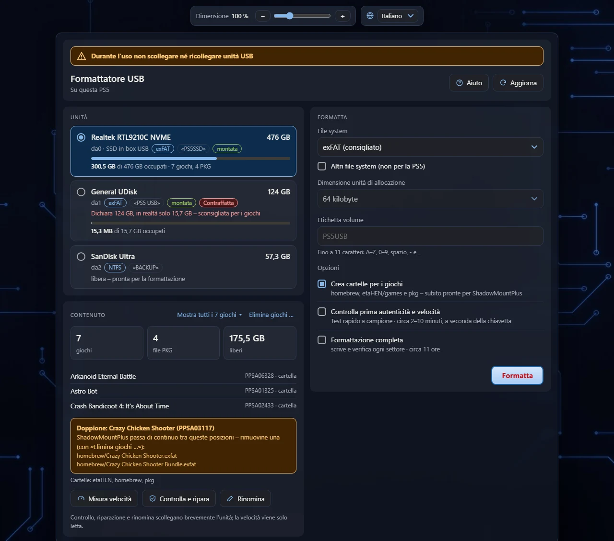
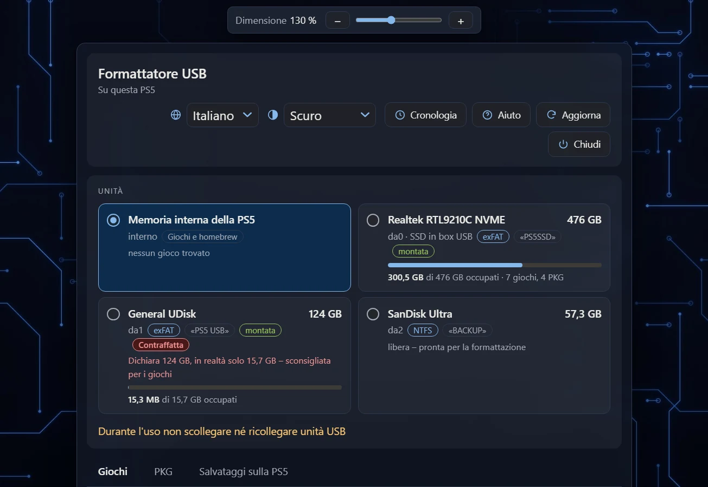
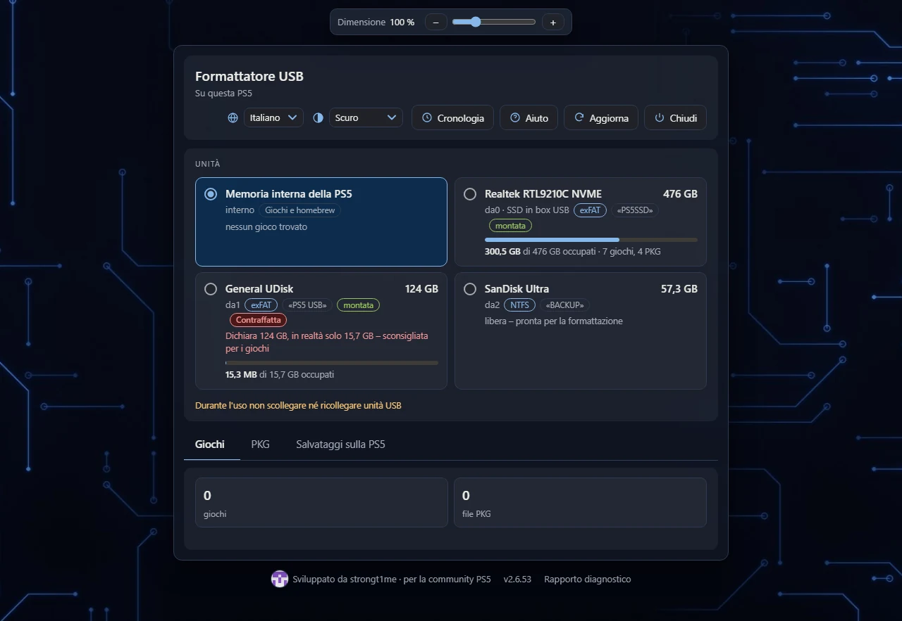
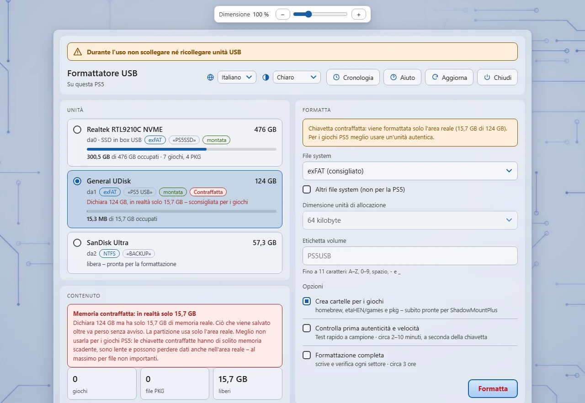
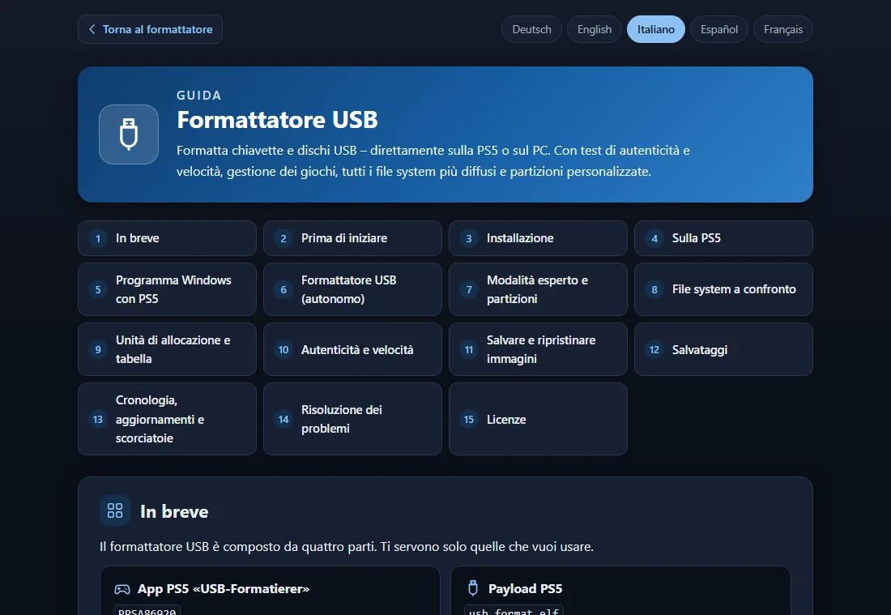
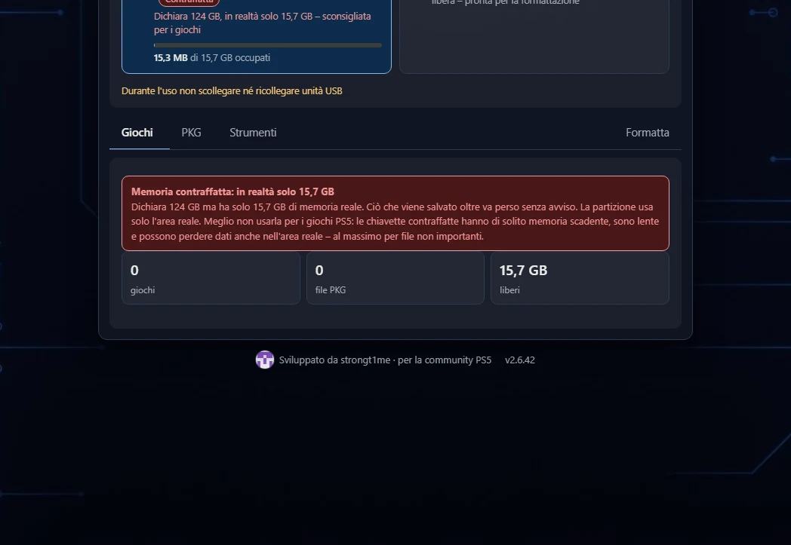
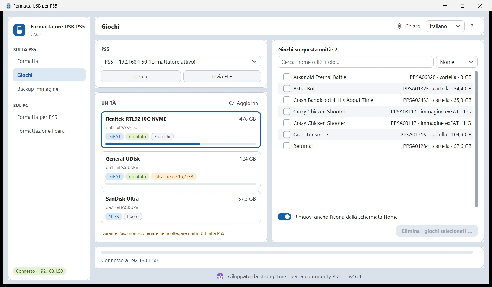
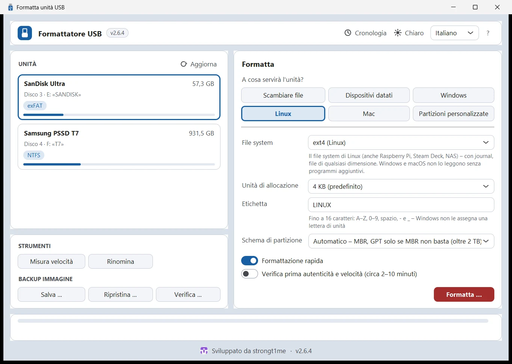
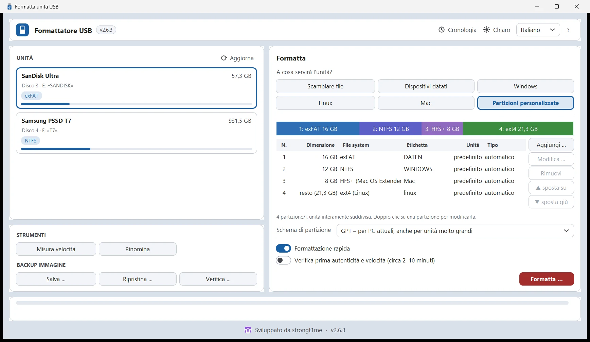

# Formattatore USB

**Formatta chiavette e dischi USB – direttamente sulla PS5 o sul PC.** 
Con test di autenticità e velocità, backup immagine, gestione dei giochi, tutti i file system più diffusi e partizioni personalizzate.

[Funzioni](#-funzioni) · [Download](#-download) · [Avvio rapido](#-avvio-rapido) · [Schermate](#-schermate) · [Compilazione](#-compilazione) · [Licenze](#-licenze)

[Deutsch](README.de.md) · [English](README.md) · **Italiano** · [Español](README.es.md) · [Français](README.fr.md)

## ✨ Funzioni

<table>
<tr>
<td width="33%" valign="top">

### 🎮 Fatto per la PS5
exFAT con 64 KB – ideale per ShadowMountPlus. Crea subito le cartelle `homebrew`, `etaHEN/games` e `pkg`. Si avvia da un proprio riquadro app.

</td>
<td width="33%" valign="top">

### 🔌 Senza scollegare
Il formattatore scollega via software le unità montate e le acquisisce prima che la PS5 le rimonti.

</td>
<td width="33%" valign="top">

### 🕹️ Giochi sotto controllo
Giochi (cartelle e immagini con ID titolo), file PKG e occupazione. Riconosce i giochi doppi, rimuove i giochi insieme al riquadro con «Elimina giochi …». I giochi si possono anche copiare o spostare tra unità e la memoria interna della PS5, con i file collegati (cartella backport, checksum); anche i file PKG si possono spostare ed eliminare. Prima della copia la destinazione viene controllata (spazio libero; FAT32 e file oltre 4 GB); i file PKG mostrano la versione del gioco e il firmware richiesto rispetto a ciò che è installato sulla PS5. Le finestre mostrano lo spazio libero rimanente; una copia interrotta riprende da dove si era fermata (stessa selezione); «Controlla giochi» confronta le immagini con il loro file .sha256; nei doppioni si vede quale versione è più vecchia; l'elenco dei giochi è ricercabile. L'app Windows registra gli errori imprevisti e offre «Copia rapporto» (Ctrl+Maiusc+B). Le copie parziali rimaste vengono mostrate e si possono scartare; «Crea checksum» scrive un .sha256 accanto alle immagini che non ne hanno; un clic su un gioco mostra i dettagli; «Seleziona la versione più vecchia» preseleziona il doppione vecchio da eliminare. «Pulisci» trova i resti (checksum senza gioco, cartelle backport senza gioco, cartelle di gioco vuote) ed elimina solo ciò che è selezionato; i giochi in cartella ottengono un elenco di checksum (<nome>.manifest.sha256) che segnala file modificati, mancanti e nuovi; più copie si possono mettere in coda ed eseguire una dopo l'altra; la pagina web offre un rapporto diagnostico copiabile. I programmi compilati superano un autotest in CI (traduzioni, checksum dell'helper, ELF incorporata, tutte le schede).

</td>
</tr>
<tr>
<td valign="top">

### 🛡️ Test di autenticità
Riconosce le chiavette con capacità contraffatta e, se vuoi, formatta solo l'area reale. Misura la velocità di lettura e scrittura.

</td>
<td valign="top">

### 🧩 Tutti i file system
exFAT, FAT32 (anche oltre 32 GB), NTFS, FAT16, ext4/ext3/ext2 e HFS+ – unità di allocazione a scelta.

</td>
<td valign="top">

### 🗂️ Modalità esperto
Più partizioni con MBR (fino a 4) o GPT (fino a 16): file system, dimensione, tipo, etichetta, avviabile.

</td>
</tr>
<tr>
<td valign="top">

### 🩺 Controlla e ripara
Controlla e ripara exFAT, rinomina le unità senza perdere dati, formattazione completa che scrive e verifica ogni settore.

</td>
<td valign="top">

### 🌍 Cinque lingue
Deutsch, English, Italiano, Español e Français – con una guida dettagliata dietro il pulsante «Aiuto».

</td>
<td valign="top">

### 📱 Usalo ovunque
Browser della PS5, smartphone o PC (codice QR) e due programmi per PC, per Windows e Linux. Tema chiaro o scuro, dimensione regolabile.

</td>
</tr>
<tr>
<td valign="top">

### 📤 Invia ELF
Il programma per PC invia il formattatore integrato alla PS5 con un clic (porta 9021) – e sostituisce una versione precedente già attiva.

</td>
<td valign="top">

### 📡 Trova la PS5
I programmi per PC trovano da soli la PS5 nella rete domestica – anche da WSL o da una macchina virtuale.

</td>
<td valign="top">

### 🔒 Niente scambi
Controllo del numero di serie: se nel frattempo è inserita un'altra chiavetta dello stesso modello, non viene formattato nulla. Dopo l'esito «falsificata» o «difettosa» il vecchio file system mezzo sovrascritto viene rimosso.

</td>
</tr>
<tr>
<td colspan="3" valign="top">

### 💾 Salvare e ripristinare immagini
Salva un'intera unità come <code>.img.zst</code> – solo le aree occupate, compresse con zstd, con <code>.sha256</code>. Sulla PS5 nella memoria interna, su un'altra unità USB o come download; sul PC in qualsiasi cartella, anche da chiavette e schede SD con la protezione da scrittura attiva. Riscrittura con verifica finale – anche caricando il file da telefono o PC. Con <code>zstd -d</code> il file diventa una normale immagine.

### 🎮 Salvataggi: backup e ripristino
Mostra i salvataggi PS5 con nome del gioco e utente, ne fa selezionare più di uno e li salva – come download ZIP o sulla PS5 stessa (interna <code>/data/game_saves</code> o <code>game_saves</code> di un'unità USB). Il contenitore cifrato resta invariato. Per il ripristino il formattatore elenca i backup trovati per utente (o si usa uno ZIP del dispositivo). I checksum vengono verificati, un gioco in esecuzione impedisce le modifiche. Salvataggi PS5 e PS4 (PS4 con il file chiave), la seconda copia di sistema (sce_bu) non viene elencata; backup e ripristino si possono annullare.

</td>
</tr>
<tr>
<td valign="top">

### 🕓 Cronologia
Le ultime operazioni con l'esito – sulla PS5 e sul PC. Ogni unità mostra cosa le è successo per ultimo.

</td>
<td valign="top">

### 🔔 Sempre aggiornato
Avviso di nuove versioni nell'interfaccia web e nei programmi per PC; «Novità» con il download del file giusto e del suo checksum.

</td>
<td valign="top">

### ⌨️ Scorciatoie
Programmi per PC: F1 guida, F5 rileggi, Ctrl+1 … 5 pagine, Ctrl+F cerca giochi, Ctrl+H cronologia.

</td>
</tr>
</table>

## 📦 Download

Tutti i file sono nell'[ultima release](../../releases/latest).

| File | A cosa serve |
|---|---|
| `PPSA86920.zip` | **Riquadro app per la PS5:** estrai e copia la cartella `PPSA86920` in `/data/homebrew/` (ad es. via FTP). ShadowMountPlus registra l'app. |
| `usb_format.elf` | **Il formattatore (payload).** L'app lo avvia da sola, il programma per PC lo invia con «Invia ELF»; altrimenti invialo a mano all'ELF loader (porta 9021). |
| `PS5-USB-Formatierer.exe` | **Programma Windows con funzioni PS5:** «Sulla PS5» (in rete), «Sul PC – per PS5», «Sul PC – libero» – con l'ELF integrato. |
| `USB-Formatierer.exe` | **Programma Windows senza funzioni PS5:** tutti i file system, partizioni e modalità esperto. |
| `PS5-USB-Formatierer-x86_64.AppImage` `USB-Formatierer-x86_64.AppImage` | **Gli stessi due programmi per Linux** come AppImage: rendilo eseguibile (`chmod +x`) e avvialo – nessuna installazione. Per ARM64 (ad es. Raspberry Pi 4/5) usa i file con `aarch64`. |
| `PS5-USB-Formatierer-linux-x86_64.tar.gz` `USB-Formatierer-linux-x86_64.tar.gz` | Gli stessi programmi Linux come archivio: estrai e avvia (anche come `aarch64`). |
| `SHA256SUMS` | **Checksum di tutti i file** per controllare i download: `sha256sum -c --ignore-missing SHA256SUMS` (Windows: `certutil -hashfile <file> SHA256`). |

**Requisiti:** una PS5 con jailbreak attivo ed ELF loader (testato con il firmware 12.00); ShadowMountPlus per il riquadro app e per eliminare i giochi. Windows 10 o 11 (64 bit); per formattare sul PC, Windows chiede una volta i diritti di amministratore. Linux (x86_64 o ARM64): per formattare, il sistema chiede la password di amministratore (pkexec/polkit); NTFS, FAT16 ed ext li scrivono gli strumenti di sistema di `ntfs-3g`, `dosfstools` ed `e2fsprogs`.

## 🚀 Avvio rapido

1. **Installa:** copia la cartella `PPSA86920` dello ZIP in `/data/homebrew/` sulla PS5.
2. **Avvia:** carica il jailbreak e apri il riquadro **USB-Formatierer**. L'interfaccia compare nel browser della PS5 – con il codice QR o su `http://<IP-PS5>:8090` anche su smartphone o PC. Senza riquadro: nel programma per PC «PS5-USB-Formatierer» fai clic su **Invia ELF**.
3. **Formatta:** scegli l'unità, imposta file system ed etichetta, premi **Formatta** – fatto.

> [!WARNING]
> Durante l'uso non scollegare né ricollegare unità USB alla PS5. La PS5 le collega ai giochi e alle app in esecuzione – dopo spesso questi ripartono solo dopo un riavvio della console. Scollega solo quando il formattatore te lo chiede esplicitamente.

Il pulsante **Aiuto** apre la guida dettagliata in cinque lingue – nell'interfaccia web e nei programmi per PC.

## 🖼️ Schermate

<table>
<tr>
<td width="50%" align="center"> <b>Nel browser della PS5 sul televisore</b></td>
<td width="50%" align="center"> <b>Conferma – se l'unità contiene giochi, va confermato esplicitamente</b></td>
</tr>
<tr>
<td align="center"> <b>Tema chiaro – chiavetta contraffatta riconosciuta, si usa solo l'area reale</b></td>
<td align="center"> <b>Guida in cinque lingue dietro il pulsante «Aiuto»</b></td>
</tr>
<tr>
<td colspan="2" align="center"> <b>Salvare e ripristinare immagini – nella memoria interna, su un'altra unità USB o come download</b></td>
</tr>
<tr>
<td align="center"> <b>Windows: Sulla PS5 – trova da solo la PS5, «Invia ELF» le invia il formattatore</b></td>
<td align="center"> <b>Windows: Formattatore USB – tutti i file system</b></td>
</tr>
<tr>
<td colspan="2" align="center"> <b>Modalità esperto – partizioni personalizzate con exFAT, NTFS, HFS+ ed ext4</b></td>
</tr>
</table>

## 🛠️ Compilazione

| Parte | Come fare |
|---|---|
| Payload e avvio dell'app | WSL/Linux con [ps5-payload-sdk](https://github.com/ps5-payload-dev/sdk): `make -C usb_format all app PS5_PAYLOAD_SDK=…` (`app` richiede `ps5-native-tool`, vedi `usb_format/app/build_title.sh`) |
| Cartella dell'app | `usb_format/dump/build.ps1` (.NET 10) |
| Programmi Windows | `windows/build_exe.bat` (strumenti: `pip install -r windows/requirements-build.txt`) – compila anche l'helper `usbfmt_win.exe` e `mke2fs.exe` |
| Programmi Linux | `windows/build_linux.sh [usb_format.elf]` (Python 3 con tkinter, PyInstaller e Pillow, gcc) – compila anche l'helper `usbfmt_linux`. La CI (`.github/workflows/linux.yml`) compila e verifica tutto su Ubuntu, anche su dispositivi loop. |
| Test | Linux/WSL: `usb_format/test/*.sh`, interfaccia web: `node usb_format/test/web_logic_test.js usb_format/web/index.html` |
| Aggiornare la propria PS5 | `python tools/ps5_deploy.py update --host <IP-PS5>` – cartella dell'app (salvata prima) e formattatore; poi `… tile` per il riquadro |
| Traduzioni | `usb_format/i18n/*.json` (`tools/i18n_gen.py`, `tools/web_i18n.py`) e `windows/i18n_app.json` (`windows/i18n_check.py`) |

## 📄 Licenze

Il Formattatore USB è distribuito con licenza [GNU General Public License 3.0](LICENSE). Il codice di terze parti incluso mantiene la propria licenza:

- `usb_format/third_party/exfatprogs` – exfatprogs 1.4.3, **GPL-2.0-or-later** (fsck.exfat è integrato nel formattatore, quindi anche `usb_format.elf` è soggetto alla GPL)
- `usb_format/tools/bin` – mkntfs (ntfs-3g) e mke2fs (e2fsprogs), GPL, vedi `THIRD_PARTY_NOTICES.txt`
- `windows/mke2fs` – mke2fs da e2fsprogs 1.47.4 per ext2/3/4 sul PC, GPL, vedi `NOTICE.txt`
- `usb_format/app/sce_module/libc.prx` – GPL-3.0-or-later, vedi `NOTICE.txt`
- `usb_format/third_party/zstd` – zstd 1.5.7 (Meta Platforms) per il backup immagine, **licenza BSD** (o GPL-2.0), vedi `LICENSE` lì

Uso a proprio rischio – fai prima un backup dei dati importanti.

Sviluppato da <a href="https://github.com/strongt1me">strongt1me</a> · per la community PS5

