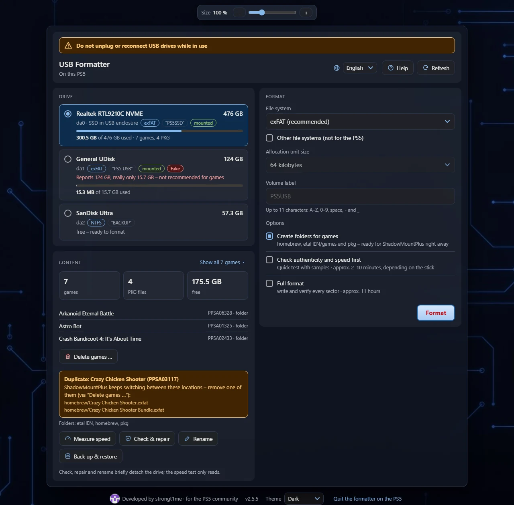
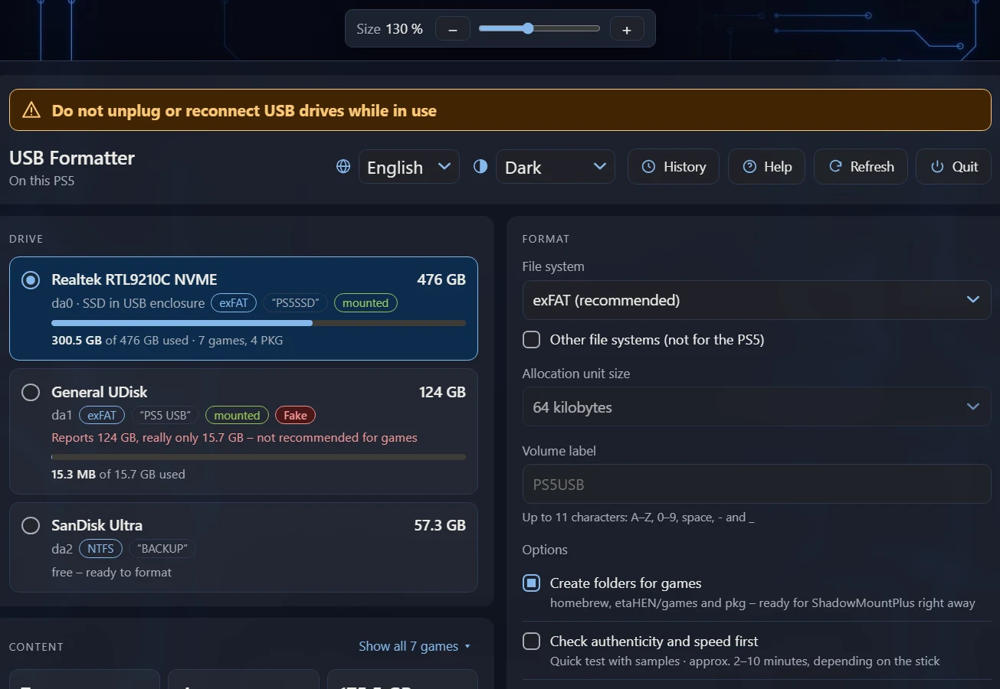
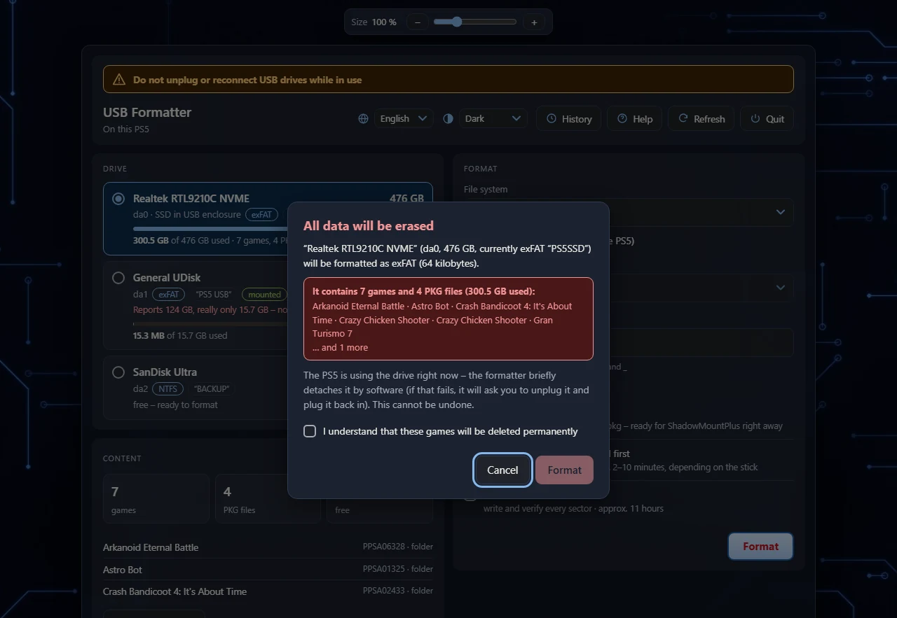
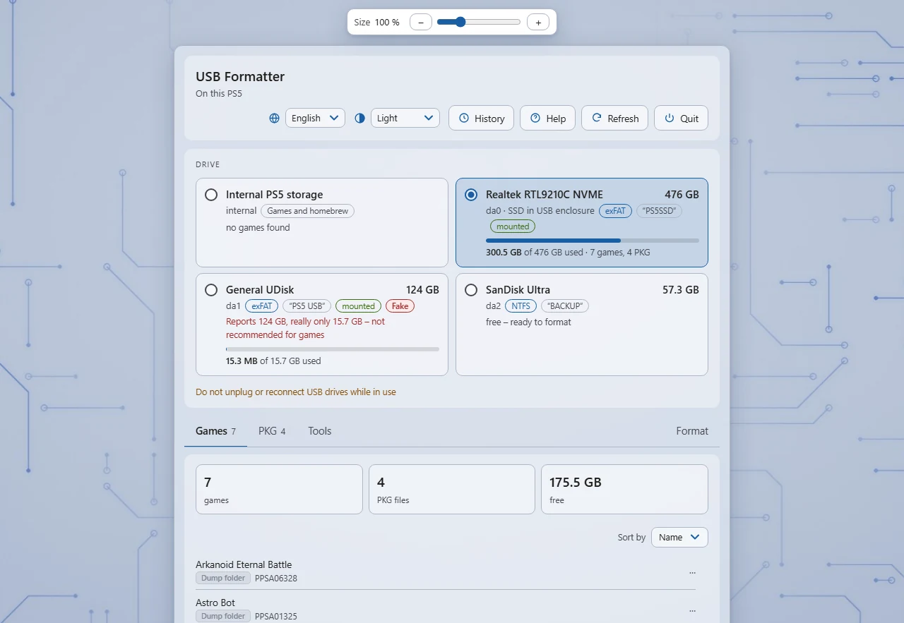
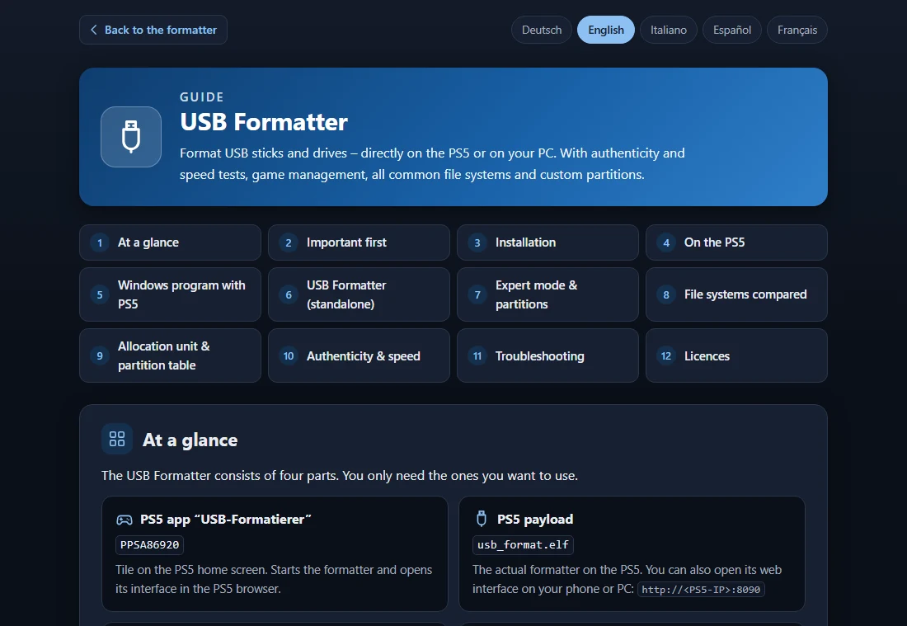
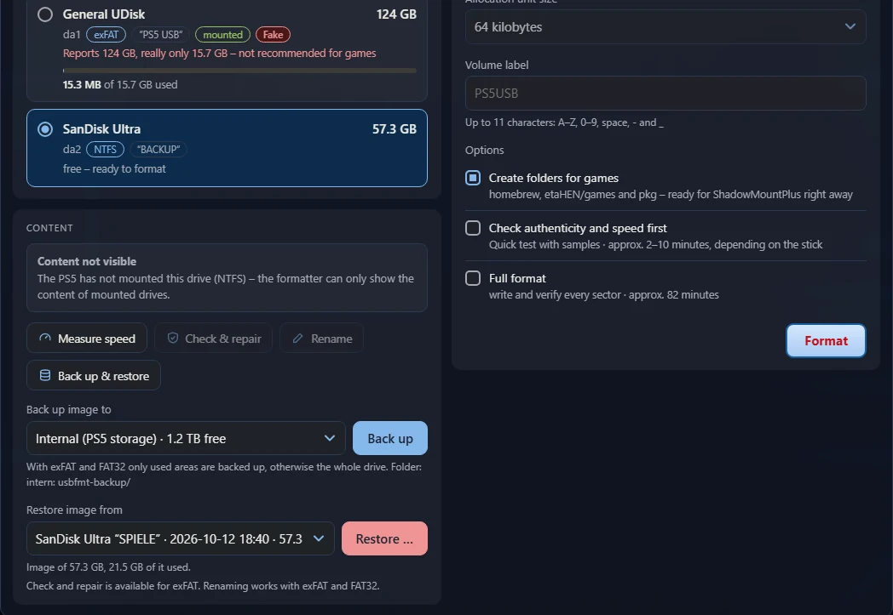
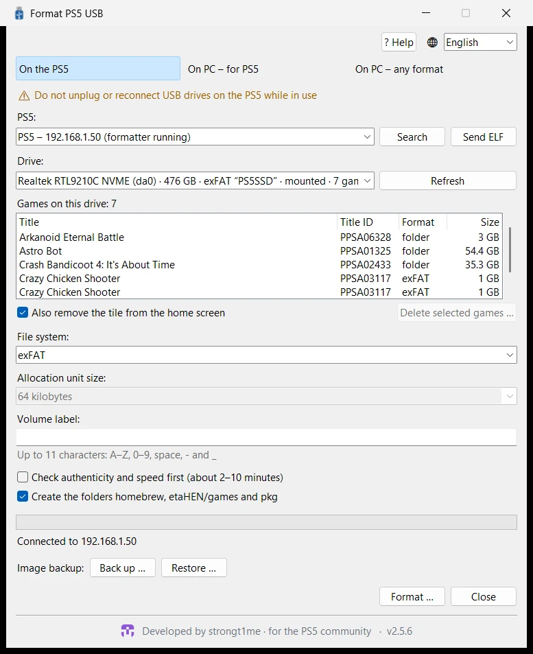
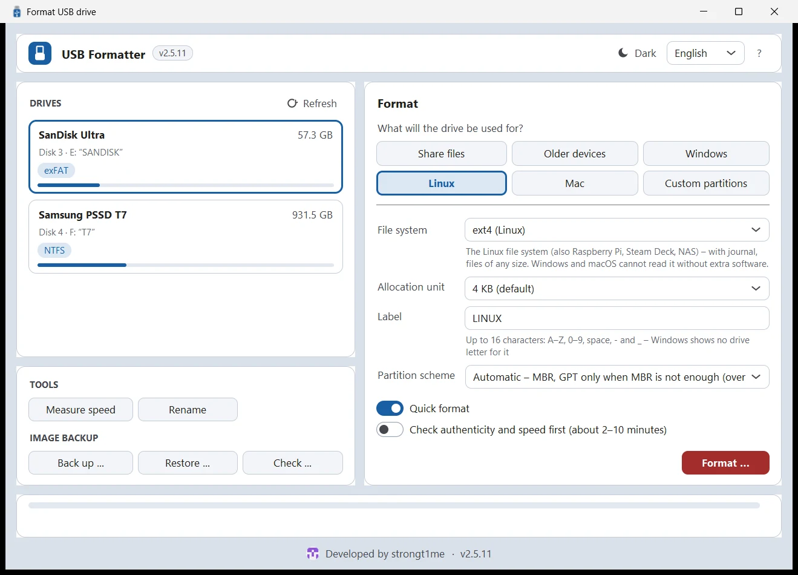
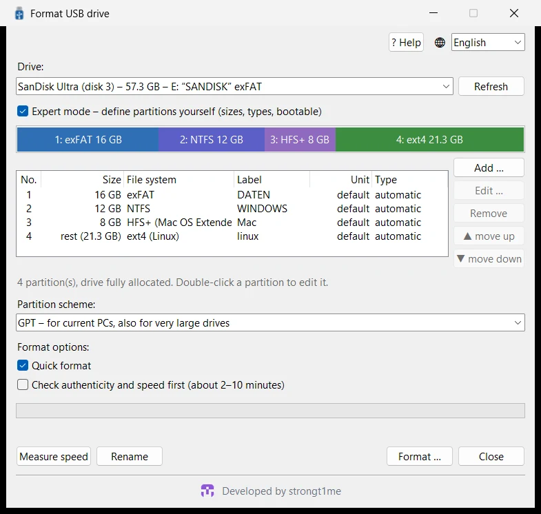

# USB Formatter

**Format USB sticks and drives – directly on the PS5 or on your PC.** 
With authenticity and speed tests, image backup, game management, all common file systems and custom partitions.

[Features](#-features) · [Download](#-download) · [Quick start](#-quick-start) · [Screenshots](#-screenshots) · [Building](#-building) · [Licences](#-licences)

[Deutsch](README.de.md) · **English** · [Italiano](README.it.md) · [Español](README.es.md) · [Français](README.fr.md)

## ✨ Features

<table>
<tr>
<td width="33%" valign="top">

### 🎮 Made for the PS5
exFAT with 64 KB – ideal for ShadowMountPlus. Creates the folders `homebrew`, `etaHEN/games` and `pkg` right away. Starts from its own app tile.

</td>
<td width="33%" valign="top">

### 🔌 No unplugging
The formatter detaches mounted drives by software and takes them over before the PS5 mounts them again.

</td>
<td width="33%" valign="top">

### 🕹️ Games at a glance
Games (folders and images with title ID), PKG files and usage. Detects duplicate games, removes games including their tile via “Delete games …”.

</td>
</tr>
<tr>
<td valign="top">

### 🛡️ Authenticity test
Detects sticks with a fake capacity and, if you like, formats only the real area. Measures read and write speed.

</td>
<td valign="top">

### 🧩 All file systems
exFAT, FAT32 (even above 32 GB), NTFS, FAT16, ext4/ext3/ext2 and HFS+ – with any allocation unit.

</td>
<td valign="top">

### 🗂️ Expert mode
Several partitions with MBR (up to 4) or GPT (up to 16): file system, size, type, label, bootable.

</td>
</tr>
<tr>
<td valign="top">

### 🩺 Check & repair
Check and repair exFAT, rename drives without losing data, full format that writes and verifies every sector.

</td>
<td valign="top">

### 🌍 Five languages
Deutsch, English, Italiano, Español and Français – with a detailed guide behind the “Help” button.

</td>
<td valign="top">

### 📱 Use it anywhere
PS5 browser, phone or PC (QR code) and two PC programs for Windows and Linux. Light or dark theme, adjustable size.

</td>
</tr>
<tr>
<td valign="top">

### 📤 Send ELF
The PC program sends the built-in formatter to the PS5 at the push of a button (port 9021) – and replaces an older version running there.

</td>
<td valign="top">

### 📡 Finds the PS5
The PC programs find the PS5 on your home network by themselves – even from WSL or a virtual machine.

</td>
<td valign="top">

### 🔒 No mix-ups
Serial number check: if a different stick of the same model is plugged in meanwhile, nothing is formatted. After a “fake” or “defective” result, the half-overwritten old file system is removed.

</td>
</tr>
<tr>
<td colspan="3" valign="top">

### 💾 Back up & restore images
Back up a whole drive as <code>.img.zst</code> – only used areas, compressed with zstd, with a <code>.sha256</code>. On the PS5 to internal storage, another USB drive or as a download; on the PC to any folder. Write it back with a check afterwards – also by uploading from a phone or PC. <code>zstd -d</code> turns the file into an ordinary image.

</td>
</tr>
</table>

## 📦 Download

All files are in the [latest release](../../releases/latest).

| File | Purpose |
|---|---|
| `PPSA86920.zip` | **App tile for the PS5:** unzip and copy the folder `PPSA86920` to `/data/homebrew/` (e.g. via FTP). ShadowMountPlus registers the app. |
| `usb_format.elf` | **The formatter (payload).** The app starts it by itself, the PC program sends it via “Send ELF”; otherwise send it to the ELF loader manually (port 9021). |
| `PS5-USB-Formatierer.exe` | **Windows program with PS5 features:** “On the PS5” (over the network), “On PC – for PS5”, “On PC – any format” – with the ELF built in. |
| `USB-Formatierer.exe` | **Windows program without PS5 features:** all file systems, partitions and expert mode. |
| `PS5-USB-Formatierer-linux-x86_64.tar.gz` `USB-Formatierer-linux-x86_64.tar.gz` | **The same two programs for Linux** (x86_64): unpack and start. |

**Requirements:** a PS5 with a running jailbreak and ELF loader (tested with firmware 12.00); ShadowMountPlus for the app tile and for deleting games. Windows 10 or 11 (64-bit); for formatting on the PC, Windows asks once for administrator rights. Linux (x86_64): for formatting, the system asks for the administrator password (pkexec/polkit); NTFS, FAT16 and ext are written by the system tools from `ntfs-3g`, `dosfstools` and `e2fsprogs`.

## 🚀 Quick start

1. **Install:** copy the folder `PPSA86920` from the ZIP to `/data/homebrew/` on the PS5.
2. **Start:** load the jailbreak and open the **USB-Formatierer** tile. The interface appears in the PS5 browser – via QR code or at `http://<PS5-IP>:8090` also on your phone or PC. Without the tile: click **Send ELF** in the “PS5-USB-Formatierer” PC program.
3. **Format:** choose a drive, set the file system and label, press **Format** – done.

> [!WARNING]
> Do not unplug or reconnect USB drives on the PS5 while it is in use. The PS5 attaches them to running games and apps – afterwards these often only start again after restarting the console. Only unplug when the formatter explicitly asks you to.

The **Help** button opens the detailed guide in five languages – in the web interface and in the PC programs.

## 🖼️ Screenshots

<table>
<tr>
<td width="50%" align="center"> <b>In the PS5 browser on the TV</b></td>
<td width="50%" align="center"> <b>Confirmation – games on the drive must be confirmed explicitly</b></td>
</tr>
<tr>
<td align="center"> <b>Light theme – fake stick detected, only the real area is used</b></td>
<td align="center"> <b>Guide in five languages behind the “Help” button</b></td>
</tr>
<tr>
<td colspan="2" align="center"> <b>Back up and restore images – to internal storage, another USB drive or as a download</b></td>
</tr>
<tr>
<td align="center"> <b>Windows: On the PS5 – finds the PS5 by itself, “Send ELF” sends the formatter over</b></td>
<td align="center"> <b>Windows: USB Formatter – all file systems</b></td>
</tr>
<tr>
<td colspan="2" align="center"> <b>Expert mode – custom partitions with exFAT, NTFS, HFS+ and ext4</b></td>
</tr>
</table>

## 🛠️ Building

| Part | How to |
|---|---|
| Payload and app starter | WSL/Linux with [ps5-payload-sdk](https://github.com/ps5-payload-dev/sdk): `make -C usb_format all app PS5_PAYLOAD_SDK=…` (`app` needs `ps5-native-tool`, see `usb_format/app/build_title.sh`) |
| App folder | `usb_format/dump/build.ps1` (.NET 10) |
| Windows programs | `windows/build_exe.bat` (Python with PyInstaller, Pillow and ziglang) – also builds the helper `usbfmt_win.exe` and `mke2fs.exe` |
| Linux programs | `windows/build_linux.sh [usb_format.elf]` (Python 3 with tkinter, PyInstaller and Pillow, gcc) – also builds the helper `usbfmt_linux`. The CI (`.github/workflows/linux.yml`) builds and tests everything on Ubuntu, including on loop devices. |
| Tests | Linux/WSL: `usb_format/test/*.sh` |
| Translations | `usb_format/i18n/*.json` (`tools/i18n_gen.py`, `tools/web_i18n.py`) and `windows/i18n_app.json` (`windows/i18n_check.py`) |

## 📄 Licences

The USB Formatter is licensed under the [GNU General Public License 3.0](LICENSE). Included third-party code keeps its own licence:

- `usb_format/third_party/exfatprogs` – exfatprogs 1.4.3, **GPL-2.0-or-later** (fsck.exfat is built into the formatter, so `usb_format.elf` is covered by the GPL as well)
- `usb_format/tools/bin` – mkntfs (ntfs-3g) and mke2fs (e2fsprogs), GPL, see `THIRD_PARTY_NOTICES.txt`
- `windows/mke2fs` – mke2fs from e2fsprogs 1.47.4 for ext2/3/4 on the PC, GPL, see `NOTICE.txt`
- `usb_format/app/sce_module/libc.prx` – GPL-3.0-or-later, see `NOTICE.txt`
- `usb_format/third_party/zstd` – zstd 1.5.7 (Meta Platforms) for the image backup, **BSD licence** (or GPL-2.0), see `LICENSE` there

Use at your own risk – back up important data first.

Developed by <a href="https://github.com/strongt1me">strongt1me</a> · for the PS5 community

