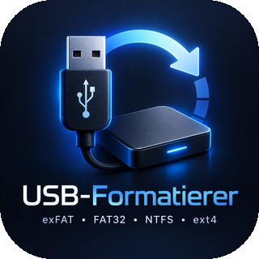
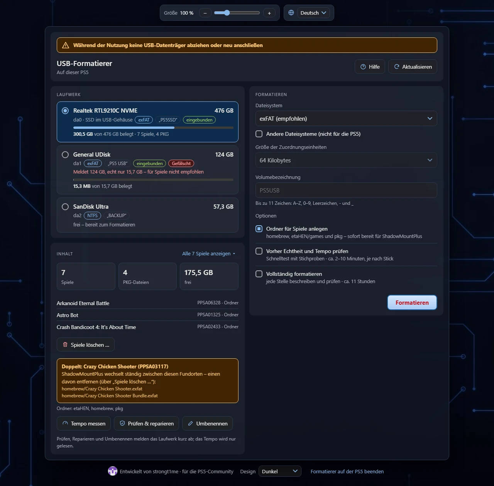
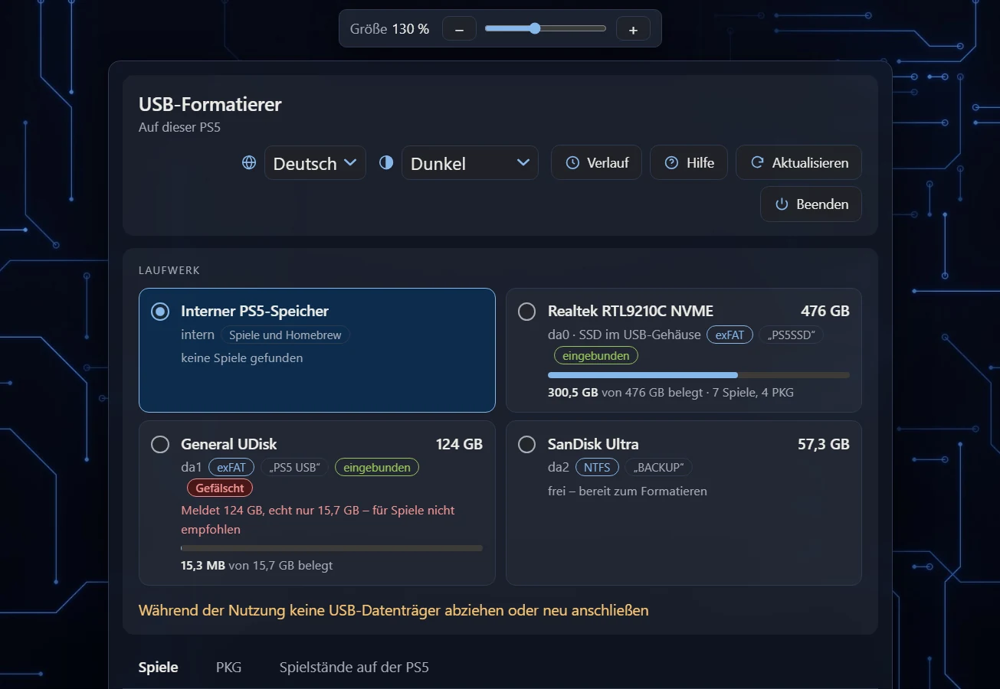
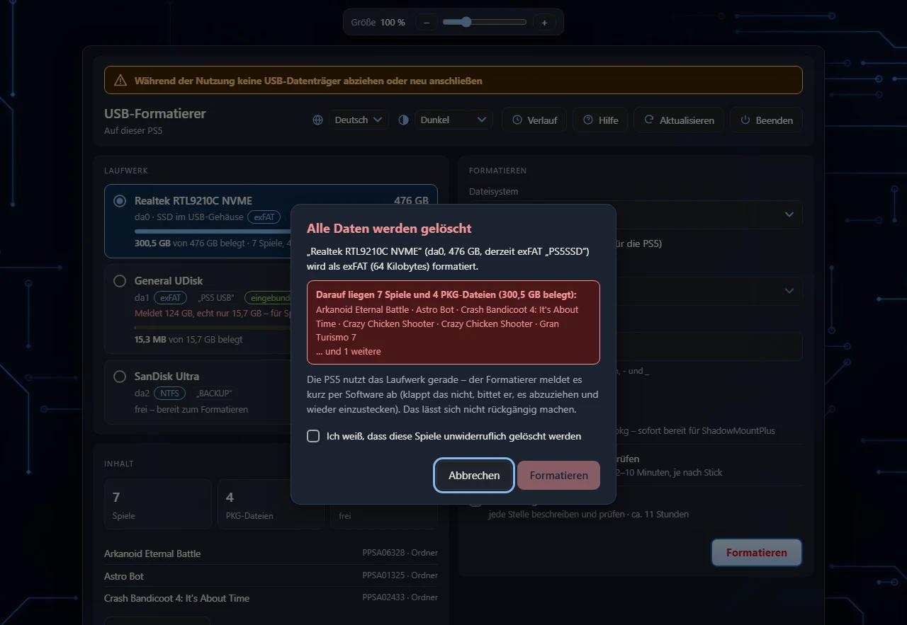
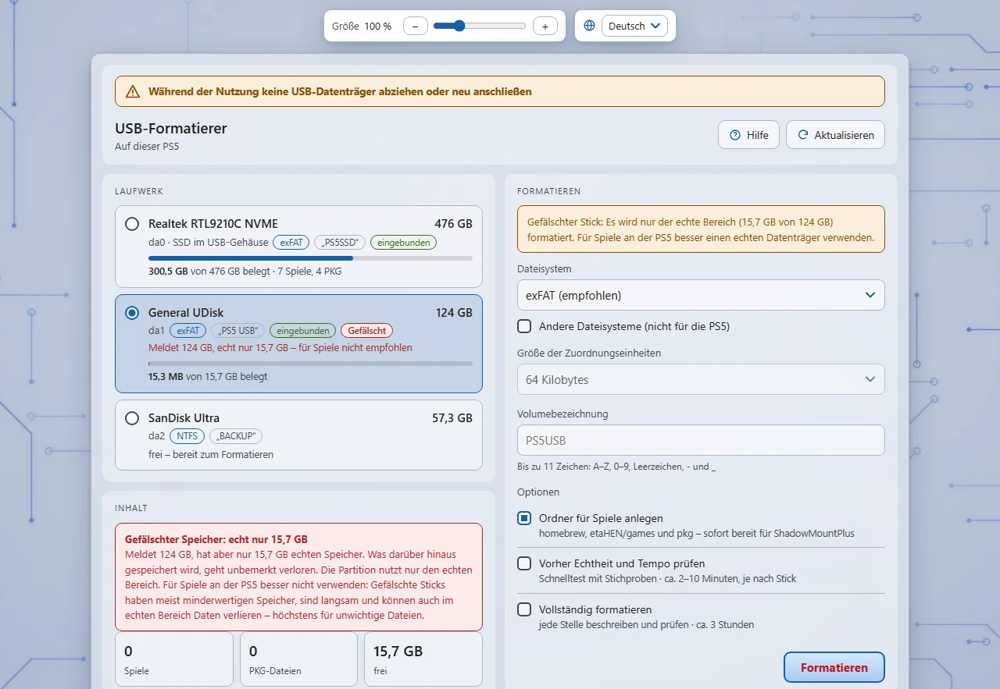
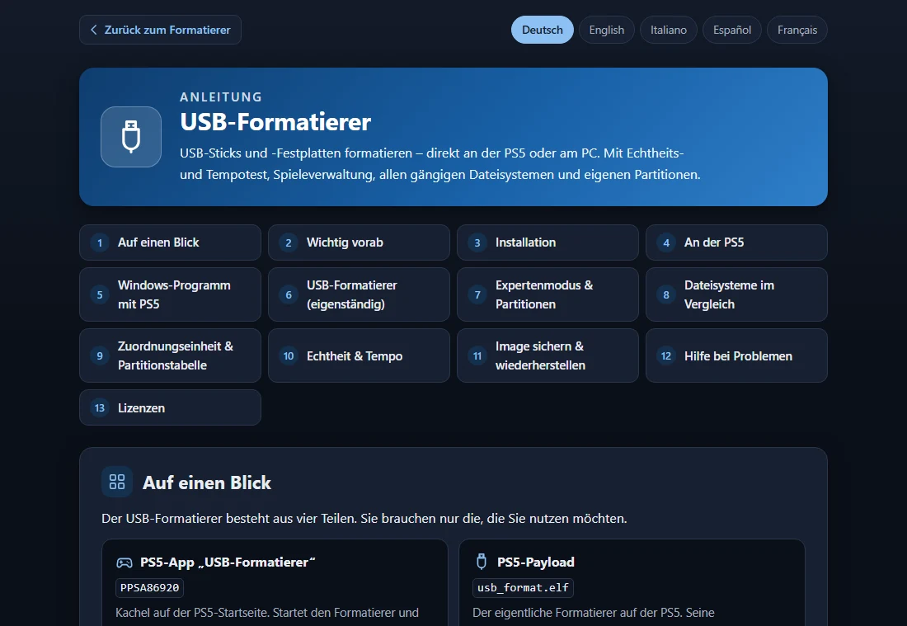
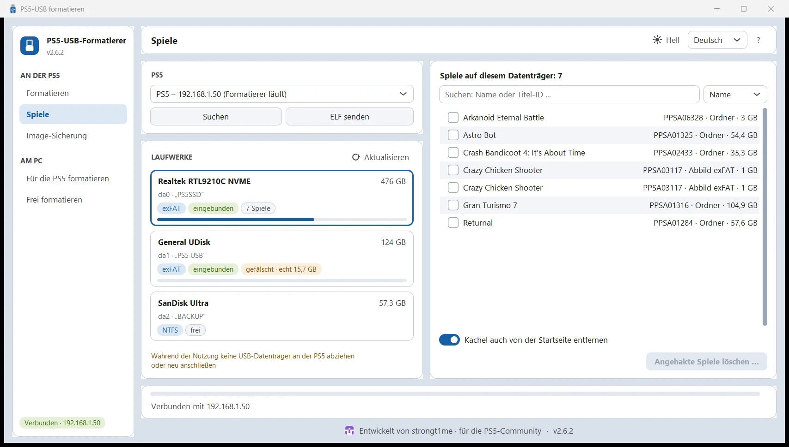
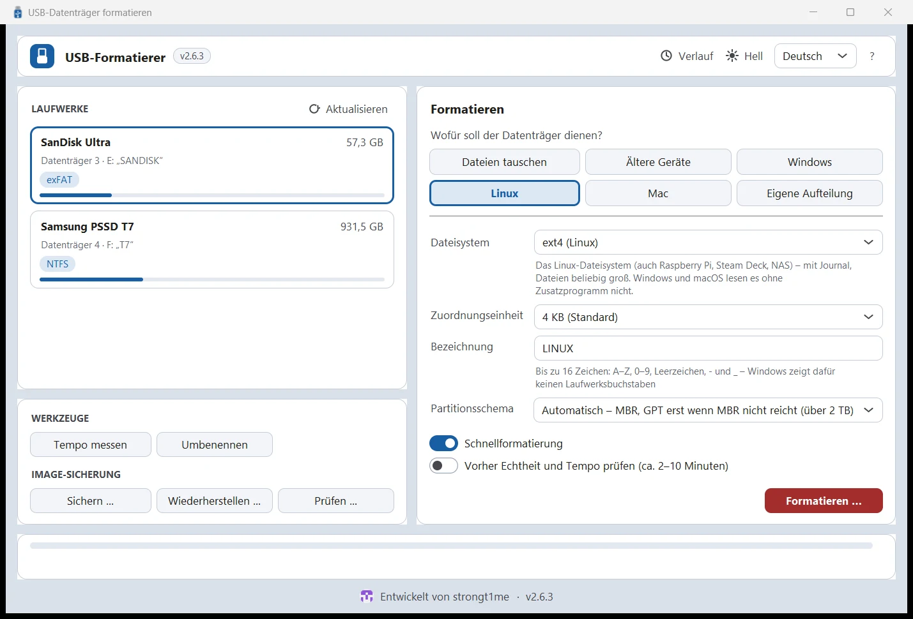
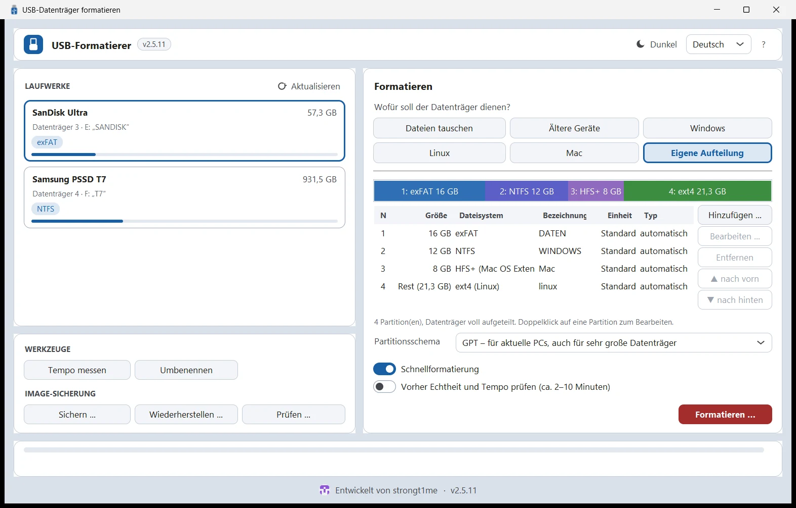

# USB-Formatierer

**USB-Sticks und -Festplatten formatieren – direkt an der PS5 oder am PC.** 
Mit Echtheits- und Tempotest, Spieleverwaltung, allen gängigen Dateisystemen und eigenen Partitionen.

[Funktionen](#-funktionen) · [Download](#-download) · [Schnellstart](#-schnellstart) · [Ansichten](#-ansichten) · [Selbst bauen](#-selbst-bauen) · [Lizenzen](#-lizenzen)

**Deutsch** · [English](README.en.md) · [Italiano](README.it.md) · [Español](README.es.md) · [Français](README.fr.md)

## ✨ Funktionen

<table>
<tr>
<td width="33%" valign="top">

### 🎮 Für die PS5 gemacht
exFAT mit 64 KB – ideal für ShadowMountPlus. Ordner `homebrew`, `etaHEN/games` und `pkg` gleich mit anlegen. Start über eine eigene App-Kachel.

</td>
<td width="33%" valign="top">

### 🔌 Ohne Abziehen
Eingebundene Laufwerke meldet der Formatierer per Software ab und übernimmt sie, bevor die PS5 sie wieder einbindet.

</td>
<td width="33%" valign="top">

### 🕹️ Spiele im Blick
Spiele (Ordner und Abbilder mit Titel-ID), PKG-Dateien und Belegung. Doppelte Spiele erkennen, Spiele samt Kachel löschen.

</td>
</tr>
<tr>
<td valign="top">

### 🛡️ Echtheitstest
Erkennt Sticks mit gefälschter Größe und formatiert auf Wunsch nur den echten Bereich. Lese- und Schreibtempo messen.

</td>
<td valign="top">

### 🧩 Alle Dateisysteme
exFAT, FAT32 (auch über 32 GB), NTFS, FAT16, ext4/ext3/ext2 und HFS+ – Zuordnungseinheit frei wählbar.

</td>
<td valign="top">

### 🗂️ Expertenmodus
Mehrere Partitionen mit MBR (bis 4) oder GPT (bis 16): Dateisystem, Größe, Typ, Bezeichnung, startfähig.

</td>
</tr>
<tr>
<td valign="top">

### 🩺 Prüfen & reparieren
exFAT prüfen und reparieren, Laufwerke umbenennen ohne Datenverlust, vollständig formatieren mit Prüfung jeder Stelle.

</td>
<td valign="top">

### 🌍 Fünf Sprachen
Deutsch, English, Italiano, Español und Français – mit ausführlicher Anleitung hinter dem Knopf „Hilfe“.

</td>
<td valign="top">

### 📱 Überall bedienbar
PS5-Browser, Handy oder PC (QR-Code) und zwei PC-Programme für Windows und Linux. Hell oder dunkel, Größe einstellbar.

</td>
</tr>
</table>

## 📦 Download

Alle Dateien gibt es beim [neuesten Release](../../releases/latest).

| Datei | Wofür |
|---|---|
| `PPSA86920.zip` | **App-Kachel für die PS5:** entpacken und den Ordner `PPSA86920` nach `/data/homebrew/` kopieren (z. B. per FTP). ShadowMountPlus meldet die App an. |
| `usb_format.elf` | **Der Formatierer (Payload).** Die App startet ihn selbst; ohne App an den ELF-Loader schicken (Port 9021). |
| `PS5-USB-Formatierer.exe` | **Windows-Programm mit PS5-Funktionen:** USB an der PS5 (übers Netz), USB am PC für die PS5, Am PC Standard. |
| `USB-Formatierer.exe` | **Windows-Programm ohne PS5-Funktionen:** alle Dateisysteme, Partitionen und Expertenmodus. |
| `PS5-USB-Formatierer-linux-x86_64.tar.gz` `USB-Formatierer-linux-x86_64.tar.gz` | **Dieselben beiden Programme für Linux** (x86_64): entpacken und starten. |

**Voraussetzungen:** PS5 mit laufendem Jailbreak und ELF-Loader (getestet mit Firmware 12.00), für die App-Kachel und das Löschen von Spielen ShadowMountPlus. Windows 10 oder 11 (64 Bit); zum Formatieren am PC fragt Windows einmal nach Administratorrechten. Linux (x86_64): zum Formatieren fragt das System nach dem Administrator-Passwort (pkexec/polkit); NTFS, FAT16 und ext schreiben die Systemwerkzeuge aus `ntfs-3g`, `dosfstools` und `e2fsprogs`.

## 🚀 Schnellstart

1. **Installieren:** Ordner `PPSA86920` aus dem ZIP nach `/data/homebrew/` auf die PS5 kopieren.
2. **Starten:** Jailbreak laden und die Kachel **USB-Formatierer** öffnen. Die Oberfläche erscheint im PS5-Browser – per QR-Code oder unter `http://<PS5-IP>:8090` auch am Handy oder PC.
3. **Formatieren:** Laufwerk wählen, Dateisystem und Bezeichnung festlegen, **Formatieren** – fertig.

> [!WARNING]
> Während der Nutzung keine USB-Datenträger an der PS5 abziehen oder neu anschließen. Die PS5 bindet sie in laufende Spiele und Apps ein – danach starten diese oft erst nach einem Neustart der Konsole wieder. Abziehen nur, wenn der Formatierer ausdrücklich dazu auffordert.

Die ausführliche Anleitung in fünf Sprachen öffnet der Knopf **Hilfe** – in der Weboberfläche und in den PC-Programmen.

## 🖼️ Ansichten

<table>
<tr>
<td width="50%" align="center"> <b>Im PS5-Browser am Fernseher</b></td>
<td width="50%" align="center"> <b>Sicherheitsabfrage – liegen Spiele darauf, muss man es ausdrücklich bestätigen</b></td>
</tr>
<tr>
<td align="center"> <b>Helles Design – gefälschter Stick erkannt, nur der echte Bereich wird genutzt</b></td>
<td align="center"> <b>Anleitung in fünf Sprachen hinter dem Knopf „Hilfe“</b></td>
</tr>
<tr>
<td align="center"> <b>Windows: USB an der PS5 – findet die PS5 im Heimnetz</b></td>
<td align="center"> <b>Windows: USB-Formatierer – alle Dateisysteme</b></td>
</tr>
<tr>
<td colspan="2" align="center"> <b>Expertenmodus – eigene Partitionen mit exFAT, NTFS, HFS+ und ext4</b></td>
</tr>
</table>

## 🛠️ Selbst bauen

| Teil | So geht's |
|---|---|
| Payload und App-Starter | WSL/Linux mit [ps5-payload-sdk](https://github.com/ps5-payload-dev/sdk): `make -C usb_format all app PS5_PAYLOAD_SDK=…` (`app` braucht `ps5-native-tool`, siehe `usb_format/app/build_title.sh`) |
| App-Ordner | `usb_format/dump/build.ps1` (.NET 10) |
| Windows-Programme | `windows/build_exe.bat` (Python mit PyInstaller, Pillow und ziglang) – baut auch den Helfer `usbfmt_win.exe` und `mke2fs.exe` |
| Linux-Programme | `windows/build_linux.sh [usb_format.elf]` (Python 3 mit tkinter, PyInstaller und Pillow, gcc) – baut auch den Helfer `usbfmt_linux`. Die CI (`.github/workflows/linux.yml`) baut und testet alles unter Ubuntu, auch an Loop-Geräten. |
| Tests | Linux/WSL: `usb_format/test/*.sh` |
| Übersetzungen | `usb_format/i18n/*.json` (`tools/i18n_gen.py`, `tools/web_i18n.py`) und `windows/i18n_app.json` (`windows/i18n_check.py`) |

## 📄 Lizenzen

Der USB-Formatierer steht unter der [GNU General Public License 3.0](LICENSE). Enthaltener Fremdcode behält seine eigene Lizenz:

- `usb_format/third_party/exfatprogs` – exfatprogs 1.4.3, **GPL-2.0-or-later** (fsck.exfat ist in den Formatierer eingebunden, damit unterliegt auch `usb_format.elf` der GPL)
- `usb_format/tools/bin` – mkntfs (ntfs-3g) und mke2fs (e2fsprogs), GPL, siehe `THIRD_PARTY_NOTICES.txt`
- `windows/mke2fs` – mke2fs aus e2fsprogs 1.47.1 für ext2/3/4 am PC, GPL, siehe `NOTICE.txt`
- `usb_format/app/sce_module/libc.prx` – GPL-3.0-or-later, siehe `NOTICE.txt`

Benutzung auf eigene Gefahr – wichtige Daten vorher sichern.
